# 来源之一 · 泰伦百科（第一部：宏观生态）

本文件是 NotebookLM 的来源之一：**泰伦百科**（事实层——泰伦虫族是什么、如何运作）。
它与**导演稿**是两件不同的东西：百科只提供事实与设定依据，不提供拍摄指令；拍摄执行见「导演稿-第一部.md」。

---

## 目录

- [编制说明](#编制说明)
- [第一编 生态总论](#第一编-生态总论)
  - [第1章 虫巢意志（Hive Mind）](#第1章-虫巢意志hive-mind)
  - [第2章 入侵全周期：泰伦化改造（Tyrannoforming）](#第2章-入侵全周期泰伦化改造tyrannoforming)
  - [第3章 生物质循环与定向演化机制](#第3章-生物质循环与定向演化机制)
  - [第4章 核心术语对照表（Glossary）](#第4章-核心术语对照表glossary)
- [第二编 编年史与重大战役](#第二编-编年史与重大战役)
  - [第1章 泰伦入侵全景编年史总览（Chronological Overview）](#第1章-泰伦入侵全景编年史总览chronological-overview)
  - [第2章 远古隐秘预兆与法洛斯信标事件（The Pharos Pulse）](#第2章-远古隐秘预兆与法洛斯信标事件the-pharos-pulse)
  - [第3章 首次接触：泰兰主星惨剧与泰伦定名（The Fall of Tyran Primus）](#第3章-首次接触泰兰主星惨剧与泰伦定名the-fall-of-tyran-primus)
  - [第4章 第一次泰伦战争：贝希摩斯与马库拉格之战（First Tyrannic War）](#第4章-第一次泰伦战争贝希摩斯与马库拉格之战first-tyrannic-war)
  - [第5章 第二次泰伦战争：克拉肯扩散、伊查尔四号与伊扬登浩劫（Second Tyrannic War）](#第5章-第二次泰伦战争克拉肯扩散伊查尔四号与伊扬登浩劫second-tyrannic-war)
  - [第6章 克里普特曼的焦土决策与警戒线争议（Kryptman's Scorched Earth & Cordon）](#第6章-克里普特曼的焦土决策与警戒线争议kryptmans-scorched-earth--cordon)
  - [第7章 第三次泰伦战争：利维坦崛起与奥克塔利斯战争（Third Tyrannic War & Octarius War）](#第7章-第三次泰伦战争利维坦崛起与奥克塔利斯战争third-tyrannic-war--octarius-war)
  - [第8章 巴尔之劫：圣血军团绝唱、亚空间裂隙与原铸黎明（The Devastation of Baal）](#第8章-巴尔之劫圣血军团绝唱亚空间裂隙与原铸黎明the-devastation-of-baal)
  - [第9章 第四次泰伦战争与利维坦西线大攻势（Fourth Tyrannic War）](#第9章-第四次泰伦战争与利维坦西线大攻势fourth-tyrannic-war)
  - [第10章 不屈远征时期最新战术演进与全域围困格局（Indomitus Era Developments）](#第10章-不屈远征时期最新战术演进与全域围困格局indomitus-era-developments)
  - [第11章 重大战役全要素对照表（Major Campaigns Summary）](#第11章-重大战役全要素对照表major-campaigns-summary)
- [第三编 生物图鉴](#第三编-生物图鉴)
  - [第1章 生物形态功能分工总览](#第1章-生物形态功能分工总览)
  - [第2章 指挥与突触生物（Command & Synapse Creatures）](#第2章-指挥与突触生物command--synapse-creatures)
  - [第3章 步兵与突击生物（Infantry & Assault Creatures）](#第3章-步兵与突击生物infantry--assault-creatures)
  - [第4章 重型与攻城生物（Heavy & Siege Creatures）](#第4章-重型与攻城生物heavy--siege-creatures)
  - [第5章 支援与生产生物（Support & Production Creatures）](#第5章-支援与生产生物support--production-creatures)
  - [第6章 飞行与特殊生物（Flying & Special Organisms）](#第6章-飞行与特殊生物flying--special-organisms)
  - [第7章 泰伦解剖学通用武器共生体系（Summary of Bio-Weapon Systems）](#第7章-泰伦解剖学通用武器共生体系summary-of-bio-weapon-systems)
- [第四编 虫巢舰队与生物舰](#第四编-虫巢舰队与生物舰)
  - [第1章 虫巢舰队与虚空生物舰概览](#第1章-虫巢舰队与虚空生物舰概览)
  - [第2章 虫巢舰队全谱系战史与适应性剖析（舰队谱系）](#第2章-虫巢舰队全谱系战史与适应性剖析舰队谱系)
  - [第3章 虚空生物舰解剖学与生态位分类（生物舰图鉴）](#第3章-虚空生物舰解剖学与生态位分类生物舰图鉴)
  - [第4章 虚空生物舰重型武器与生化阵列](#第4章-虚空生物舰重型武器与生化阵列)
  - [第5章 战役实录对比：帝国战术教条演变](#第5章-战役实录对比帝国战术教条演变)
  - [第6章 虚空核心术语与舰船代号对照表（Glossary）](#第6章-虚空核心术语与舰船代号对照表glossary)
- [第五编 基因窃取者教派与帝国的反制](#第五编-基因窃取者教派与帝国的反制)
  - [第1章 基因窃取者教派（Genestealer Cults）专题](#第1章-基因窃取者教派genestealer-cults专题)
  - [第2章 帝国的认知、监控与战略反制](#第2章-帝国的认知监控与战略反制)
  - [第3章 核心术语对照表（Glossary）](#第3章-核心术语对照表glossary-1)
- [附录：学术辨析与争议考证汇总](#附录学术辨析与争议考证汇总)
  - [一、生态与演化篇学术辨析与待考设定](#一生态与演化篇学术辨析与待考设定)
  - [二、战役编年史学术争议与考证（Scholarly Appendix & Debates）](#二战役编年史学术争议与考证scholarly-appendix--debates)
  - [三、虚空舰队与生物舰战术考证与争议说明](#三虚空舰队与生物舰战术考证与争议说明)
  - [四、基因窃取者教派与反制战略学术辨析与争议设定（Academic Annotations）](#四基因窃取者教派与反制战略学术辨析与争议设定academic-annotations)

---

## 编制说明

> 本典籍《泰伦百科·第一部（扩充版）》系统考证战锤40K中泰伦虫族（Tyranids / *Tyranicus Orestii*）的宏观生态学、星际航行机理、星球吞噬全周期、形态演化网络、战役编年史、地表与特化兵种全谱、虚空生物舰队以及基因窃取者先锋与帝国反制体系。全书严格遵循设定考证纪律，核心设定优先采纳战锤百科 **Lexicanum** 与 Games Workshop **官方出版物**（各版《Codex: Tyranids》、《Codex: Genestealer Cults》、《Codex: Deathwatch》、核心规则书及战役扩展书《War Zone Octarius》、《The Devastation of Baal》、《Crusade: Tyrannic War》、《Battlefleet Gothic》系列等），次要/扩展细节辅以 **Warhammer 40k Wiki (Fandom)** 并明确加注来源标签。凡存在设定冲突、帝国学者推测或法理争议的内容，均于附录或专栏予以学术辨析考订。全书严格遵循客观百科编纂规范，唯录严谨设定事实，恪守实录纪律，杜绝戏剧化编排与文学性修辞。

---

## 第一编 生态总论

### 第1章 虫巢意志（Hive Mind）

#### 1.1 本质与本体结构
* **超个体泛灵能意识集合体（Gestalt Consciousness）**：虫巢意志并非具有单一实体神格或发号施令的中央实体，而是由不可计数的数万亿泰伦个体生物的心智与灵能火花彼此交织、汇聚而成的宇宙级集体潜意识 [Lexicanum] [官方: Codex: Tyranids (5th Edition)]。
* **超越物理维度的神性存在**：在亚空间维度中，虫巢意志展现为一头难以名状、无法丈量的永恒饥饿巨兽。审判庭与灵族先知均指出，虫巢意志的灵能投影规模甚至超越了凡间绝大多数实体神祇，其意志纯粹且统一，没有任何凡人意义上的同情、怜悯或迟疑，唯一驱动力是生存、进化与对有机质的无限摄取 [Lexicanum] [官方: Codex: Tyranids (8th Edition)]。

#### 1.2 与个体生物的连接机制：突触网络（Synapse Network）
* **突触分层结构**：虫巢意志借助灵能频率构建了一套层级极为严密的神经网状结构——**突触网络（Synapse Network）** [Lexicanum] [官方: Codex: Tyranids (4th Edition)]。
  1. **主脑级中枢（Primary Nodes）**：由太空中的诺恩虫后（Norn-Queen）与母舰虫巢心智构成，统御整个舰队的战略目标 [Lexicanum]。
  2. **战场指挥中枢（Commander Synapses）**：如群虫领主（The Swarmlord）、虫巢暴君（Hive Tyrant）与诺恩使者（Norn Emissary），拥有极高的人格化战场决策权与战术即时演算能力 [Lexicanum] [官方: Warhammer 40,000 (10th Edition)]。
  3. **战术突触锚点（Relay Synapses）**：如泰伦武士（Tyranid Warriors）、佐安索普（Zoanthrope）与神经虫群，作为中继天线将意志辐射至低等炮灰生物 [Lexicanum]。
* **本能行为退化（Instinctive Behaviour）**：低阶生物（如霍玛冈特、泰马冈特）仅具备微弱的动物性本能脑。一旦其身侧的突触生物被击杀，低阶生物会瞬间脱离虫巢意志的心智压制，退化至原始的**本能行为**——通常表现为惊恐溃逃（潜伏本能 Lurk）或无脑自相残杀/疯狂攻击最近的活物（吞噬本能 Feed）[Lexicanum] [官方: Codex: Tyranids (8th Edition)]。

#### 1.3 亚空间阴影（Shadow in the Warp）
* **物理机制**：并非传统意义上“抚平”或“消除”亚空间波动，而是亿万泰伦突触生物在进行超高密度心灵通讯时，在亚空间产生的极高频、压倒性灵能共鸣杂音（Synaptic Roar）。这一现象如同一场无休止的心灵风暴，遮蔽了亚空间与现实宇宙的微弱灵能联系 [Lexicanum] [官方: Codex: Tyranids (9th Edition)]。
* **主要影响与战略压制**：
  * **星语通讯阻断（Astropathic Blackout）**：帝国的星语者在阴影笼罩下彻底失声，无法向外界发送任何求援信号，导致被攻击星系沦为银河系中的盲区与孤岛 [Lexicanum]。
  * **亚空间航行瘫痪**：航向目标星系的帝国舰船因盖拉力场（Gellar Field）受到剧烈灵能杂音震荡而发生严重畸变，领航员（Navigators）极易致盲、发疯甚至神经爆裂，导致救援舰队无法完成亚空间跃迁出水 [Lexicanum]。
  * **凡人心智崩溃与灵能反噬**：凡人守军会陷入极度的窒息感、恐惧与无尽寒意；灵能者（Psykers）更是首当其冲，直面虫巢意志浩瀚的饥饿感往往导致大脑直接物理烧毁、七窍流血发狂乃至肉体崩解 [Lexicanum] [官方: Codex: Tyranids (8th Edition)]。
  * **对恶魔与亚空间生物的驱逐**：在近期的大裂隙背景下，极强烈的亚空间阴影甚至能切断混沌恶魔与亚空间能量源的联系，导致恶魔形体不稳、直接融化解体（特别体现于克罗诺斯虫巢舰队）[Lexicanum] [官方: Codex: Tyranids (8th Edition)]。

---

---

### 第2章 入侵全周期：泰伦化改造（Tyrannoforming）

泰伦虫族对一颗猎物星球的全面吞噬是一个环环相扣、工业化般精密的生态重塑工程，帝国学者将其命名为 **“泰伦化改造”（Tyrannoforming）** 或 **“行星同化”（Planetary Assimilation）**。根据官方经典案例（如达尔基主星 Dalki Prime 观测记录），其全周期通常耗时 80 至 100 个泰拉标准日 [Lexicanum] [官方: Codex: Tyranids (5th Edition)]：

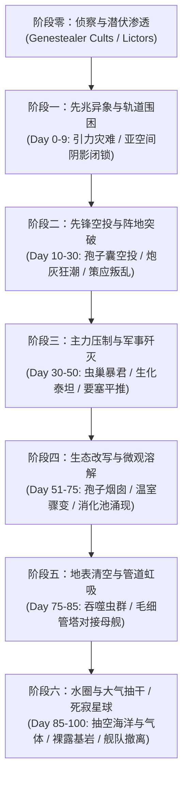

#### 阶段零：侦察与潜伏渗透（Scouting & Infiltration，入侵前数十年至数百年）
* **主导生物**：纯血基因窃取者（Purestrain Genestealers）、基因窃取者教派（Genestealer Cults）、李克特（Lictor）、死灵跳跃者（Deathleaper）[Lexicanum]。
* **生态与战略事件**：
  1. 基因窃取者通过帝国货船残骸或逃生舱隐秘散播，利用“基因窃取者之吻”感染宿主，在目标星球底层建立起潜伏四代以上的杂交教派。教派渗透至星球政界、军工与防御指挥系统 [Lexicanum] [官方: Codex: Genestealer Cults]。
  2. 轨道空投囊悄无声息地将李克特投送至荒野。李克特暗杀前哨军官，使用**喂食触须（Feeder Tendrils）**钻透受害者头骨、吸食神经中枢以提取战术情报，同时在全图释放特殊信息素轨迹（Pheromone Trails），作为母舰空投的导航信标 [Lexicanum]。

#### 阶段一：先兆异象与轨道围困（Premonition & Orbital Shadow，第 0 – 9 天）
* **主导生物**：独角鲸舰（Narvhal）、前哨生物侦察舰、极少数先锋突触中继体 [Lexicanum]。
* **生态与战略事件**：
  1. 独角鲸舰的引力聚焦导致星球内部地质应力骤增，引发大规模构造断裂、反常火山爆发与超级潮汐，重创民用交通与通讯基础设施 [Lexicanum]。
  2. 舰队主体跃出亚光速，**亚空间阴影**全面降临。星球星语通讯骤停，守军与帝国腹地的联系彻底切断；先锋空投囊（Mycetic Spores）散落于荒芜地带，开始建立地表原生菌丝网络 [Lexicanum]。

#### 阶段二：先锋空投与全面战争（Vanguard Drop & Total War，第 10 – 30 天）
* **主导生物**：轨道空投囊（Mycetic Spores）、翼手虫（Gargoyles）、霍玛冈特（Hormagaunts）、泰马冈特（Termagants）、掘地巨兽（Trygons / Raveners）[Lexicanum]。
* **生态与战略事件**：
  1. 成千上万的几丁质空投囊划破电离层，形成覆盖大陆的“生化陨石雨”。
  2. 翼手虫蔽日封锁空中支援，潜伏地底的掘地巨兽破土而出，从要塞内部突袭关键枢纽；基因窃取者教派在地表各大巢都同步发动大规模叛乱，炸毁发电厂、破坏防空导弹阵地，形成内外夹击 [Lexicanum] [官方: Codex: Tyranids (5th Edition)]。

#### 阶段三：主力压制与军事歼灭（Main Swarm & Subjugation，第 30 – 50 天）
* **主导生物**：虫巢暴君（Hive Tyrant）、刽子手（Carnifex）、外分泌生化炮兽（Exocrine）、灵能佐安索普（Zoanthrope）、生化泰坦（Hierophant）、诺恩使者（Norn Emissary）[Lexicanum] [官方: Warhammer 40,000 (10th Edition)]。
* **生态与战略事件**：
  1. 母舰低轨悬停，遮天蔽日。高阶突触节点全面介入，战场协同达到微秒级响应。
  2. 攻城巨兽与生化泰坦平推重装甲阵地，生物等离子巨炮将防御要塞熔化为炽热残渣；诺恩使者受虫后直遣，单枪匹马强行斩首敌军最高指挥层。至第 50 天前后，星球一切成建制的军事反抗被彻底瓦解 [Lexicanum]。

#### 阶段四：大气改造与微观生态溶解（Atmospheric Alteration & Tyrannoforming，第 50 – 75 天）
* **主导生物**：**孢子烟囱（Spore Chimneys）**、剧毒囊兽（Toxicrene / Venomthrope）、初期消化池（Digestion Pools）[Lexicanum]。
* **生态与战略事件**：
  1. 地表破裂，数以万计的数十米高管状结构——**孢子烟囱**以惊人速度拔地而起，日夜不停地向平流层喷吐极高浓度的致死孢子、腐蚀性毒气与强酸气溶胶 [Lexicanum]。
  2. 全球大气层变为红褐色，强温室效应使地表温度骤升至潮湿酷热的温室状态；原生植被迅速发生畸变并自行溃烂液化，水体全面富营养化并发酵，空气变得剧毒且具备强酸性，无防护的凡人吸入一口即会肺部液化暴毙 [Lexicanum]。
  3. 大地低洼处开始自发渗出高酸性发泡黏液，扩张形成巨大的**消化池（Digestion Pools / Reclamation Pools）** [Lexicanum]。

#### 阶段五：地表清空与生物质回收（Biomass Reclamation & Digestion，第 75 – 85 天）
* **主导生物**：**吞噬虫群（Ripper Swarms）**、噬腐兽（Haruspex / Malanthrope）、**毛细管塔（Capillary Towers）**、低轨母舰引水管（Proboscis）[Lexicanum]。
* **生态与战略事件**：
  1. 数以万亿计的吞噬虫如同活体地毯席卷大陆，无休止地啃噬一切含碳物质（动植物尸体、残存生物、腐殖土、甚至人造塑料与电缆有机绝缘皮）[Lexicanum]。
  2. 吃得身体膨胀几倍的吞噬虫群成群结队爬向消化池，纵身跃入强酸池中，将自身肉体连同胃中物质一并溶解，化作高纯度的“**生物浓汤（Bio-slurry / Genetic Gruel）**” [Lexicanum]。
  3. 巨大的肉质与骨质结构——**毛细管塔**拔地而起，如同数公里高的活体太空电梯直穿云霄，其根系扎入消化池底部。低轨悬停的虫巢母舰垂下数公里长的吻管与毛细管塔顶端精密咬合，利用强大的括约肌与虹吸负压，将地表数亿吨生物浓汤泵入轨道母舰的储液囊中 [Lexicanum]。

#### 阶段六：水圈与大气抽干及最终撤离（Desiccation & Departure，第 85 – 100 天）
* **主导生物**：母舰虹吸管、大气冷凝瓣膜 [Lexicanum]。
* **生态与战略事件**：
  1. 在固体有机物被清空后，母舰的虹吸管道探入江河与远洋，直接抽吸数万亿吨水分，直到整颗星球的海洋底床干涸开裂，露出盐碱与海底基岩 [Lexicanum]。
  2. 最终阶段，母舰张开巨大的真空瓣膜抽吸平流层与对流层的所有气体，剥夺星球的大气层。地壳因失去巨量水体与表层重压，引发全球性地质坍塌与残余断裂喷发 [Lexicanum]。
  3. 吞噬完毕后，原星球降格为一颗无空气、无水源、无有机微生物的**死寂裸露岩球（Dead World / Barren Rock）**。虫巢舰队拔锚起航，顺着下一个引力信号消失在深空之中 [Lexicanum]。

---

---

### 第3章 生物质循环与定向演化机制

#### 3.1 基因吸收与分子解构机制
泰伦虫族体内不存在多余的浪费机制。生物质（Biomass）被摄取后，在生物化学层面会被还原至最基础的有机分子级别：
* **基因解构器官（Genetic Shredders）**：在低轨母舰内，诺恩虫后的生化腔体内含有特殊的基因粉碎器官。所有由毛细管塔泵上来的生物浓汤会被强制拆解为氨基酸链、多肽与基本核苷酸序列 [Lexicanum]。
* **活体基因库（Gene-Banks）**：虫巢意志会比对新猎物的基因片段，筛选出表达高效特征的外源序列（例如高密度骨骼角质、神经传导加速蛋白、强酸耐受性细胞膜等），并将这些优质代码融入庞大的宏观基因库中 [Lexicanum] [官方: Codex: Tyranids (8th Edition)]。

#### 3.2 吞噬特定猎物后的定向进化案例
帝国机械教生物贤者（Magos Biologis）经过数百年解剖与解密，确认了多起泰伦针对银河系主要物种基因吸收后的逆向工程产物：

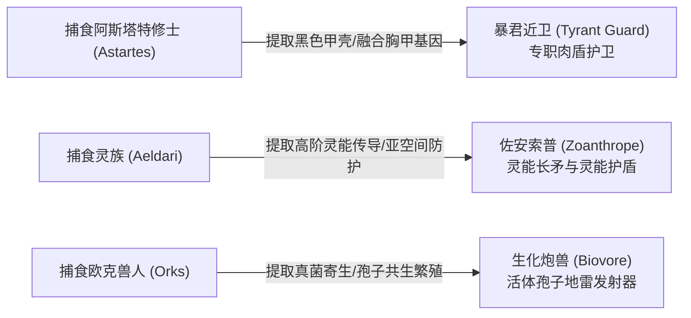

1. **阿斯塔特星际战士（Space Marines）→ 暴君近卫（Tyrant Guard）**：
   * **特征**：暴君近卫是几乎完全没有视觉器官的盲目肉盾，其外骨骼呈现出与星际战士类似的紧密肋骨板融合结构以及皮下几丁质致密层，极度类似于星际战士十九道基因种子中的“黑色甲壳（Black Carapace）”[Lexicanum]。
   * **文献考证**：机械教生物学者私下普遍认为虫族通过消化星际战士基因种子改造出了这一护卫品种，尽管帝国官方高层与审判庭严令将其定性为“异端渎圣谣言”并予以封禁，但在解剖学特征上证据极具指向性 [Lexicanum: Codex: Tyranids (4th Edition)]。
2. **艾达灵族（Aeldari）→ 佐安索普（Zoanthrope）与神经毒兽（Neurothrope）**：
   * **特征**：佐安索普呈现出严重萎缩的身体与极其夸张扩大的大脑半球，其调动亚空间能量的神经通路与灵族先知（Farseer）具有惊人的分子同源性 [Lexicanum]。
   * **进化逻辑**：在接触灵族之前，虫族灵能生物极易因亚空间反噬而大脑过载自爆；消化灵族后，虫族成功破译了构建“安全亚空间回路”与灵能护盾的遗传锁，诞生了毁灭性的佐安索普 [Lexicanum] [官方: Codex: Tyranids (3rd/5th Edition)]。
3. **欧克兽人（Orks）→ 生化炮兽（Biovore）**：
   * **特征**：生化炮兽体内的孢子地雷并非单纯的动物胚胎，而是具有极强真菌与植物共生特性的爆炸囊泡。解剖显示其生殖腔内部具备欧克特有的真菌-动物双重组织架构 [Lexicanum]。
   * **进化逻辑**：虫族通过摄取兽人的真菌孢子繁殖机制，将其与自身的神经酸液囊结合，演化出了能够自我产生、自我补充弹药的活体生化迫击炮台 [Lexicanum]。

#### 3.3 生物舰的孕育与生长方式
太空中的泰伦生物舰并非像帝国星舰那样在干船坞中由机械铆接制造，而是**完全由纯生物学生长培育而成** [Lexicanum]：
* **深空育卵带（Spawning Clusts）**：在新捕食星球的近地轨道或小行星带富集区，母舰会排泄出巨大的胶状卵鞘（Egg-sacs）。这些幼舰胚胎漂浮在低重力环境下，由专门的保姆生化兽分泌营养液浸泡 [Lexicanum] [Fandom]。
* **矿物矿渣钙化与几丁质骨架延伸**：幼体生物舰吸收被消化星球运输来的硅、铁、钙等无机矿物浆液，其内部神经脊椎骨首先成型，随后几丁质装甲像甲壳动物蜕皮一样一层层向外硬化钙化。其排气孔、消化器官与生物武器在数周内即可发育完备 [Lexicanum]。
* **成体分裂与舰队繁衍**：当一颗富饶的文明世界被彻底吞噬后，母舰所吸收的巨量生物质足以让虫巢母舰当场“分娩”或横向脱壳裂变出数艘巡洋舰级生物舰，使虫巢舰队在每次成功掠食后规模不仅不减少，反而呈指数级膨胀 [Lexicanum] [官方: Codex: Tyranids (5th Edition)]。

---

---

### 第4章 核心术语对照表（Glossary）

| 序号 | 中文术语 | 英文官方术语 | 简明释义 |
| :---: | :--- | :--- | :--- |
| 1 | **虫巢意志** | Hive Mind | 统领整个泰伦虫族的超个体泛灵能意识集合体。 |
| 2 | **亚空间阴影** | Shadow in the Warp | 亿万突触生物心灵网络在亚空间造成的通讯阻断与致疯共鸣杂音。 |
| 3 | **突触网络 / 突触生物** | Synapse Network / Synapse Creature | 虫巢意志向低等生物传递战术指令的灵能中继网络及其承载生物。 |
| 4 | **本能行为** | Instinctive Behaviour | 低阶虫族失去突触中枢控制后退化出的动物自卫或嗜血本能。 |
| 5 | **虫巢舰队** | Hive Fleet | 由成千上万艘生物舰组成、以吞噬整个星区为目标的庞大虚空集群。 |
| 6 | **生物舰** | Bio-ship | 泰伦虫族用于虚空战斗、星际运输与繁衍的活体宇宙飞船。 |
| 7 | **独角鲸舰** | Narvhal | 利用单丝触角感应星系重力并制造空间引力走廊以实现超光速航行的特化生物舰。 |
| 8 | **诺恩虫后** | Norn-Queen | 居于虫巢舰核心腹地的繁衍母体，负责基因重组、克隆与物种进化设计。 |
| 9 | **泰伦化改造** | Tyrannoforming | 虫族将猎物星球的地表、水圈与大气彻底液化回收的生态同化过程。 |
| 10 | **轨道空投囊** | Mycetic Spore | 搭载几丁质隔热外壳与减速气囊的活体单向轨道空投组织。 |
| 11 | **毛细管塔** | Capillary Tower | 高达数公里、连接地表消化池与轨道母舰的活体中空虹吸输送管道。 |
| 12 | **消化池 / 回收池** | Digestion Pool / Reclamation Pool | 地表充满高浓度强酸、用于将动植物肉体融解为生物浓汤的发泡生化酸池。 |
| 13 | **吞噬虫群** | Ripper Swarm | 成群结队啃噬地表一切有机质、最后投身消化池以完成资源回收的小型生物。 |
| 14 | **孢子烟囱** | Spore Chimney | 喷射致死微生物孢子与强酸温室气溶胶以改写行星大气层的巨大地表管状腺体。 |
| 15 | **基因窃取者教派** | Genestealer Cult | 基因窃取者在目标星球凡人社会内部建立的异端杂交邪教，作为入侵内应。 |
| 16 | **喂食触须** | Feeder Tendrils | 李克特与噬腐兽头部的吻状须，用于钻开猎物颅骨直接吸食神经中枢与记忆。 |
| 17 | **钻脑铳** | Fleshborer | 泰马冈特共生的生化枪械，发射钻入目标体内疯狂啃噬神经的甲虫弹丸。 |
| 18 | **生物浓汤 / 遗传浆液** | Bio-slurry / Genetic Gruel | 行星被消化融解后的高纯度液态基本有机分子混合物。 |
| 19 | **群虫领主** | The Swarmlord | 虫巢暴君的最高变体，具备数万年战争经验与不断在母舰池中转生记忆的能力。 |
| 20 | **诺恩使者** | Norn Emissary | 第十版最新登场的虫后直属近卫刺客生物，专职定点清除敌军战略统帅。 |

---

---

## 第二编 编年史与重大战役

### 第1章 泰伦入侵全景编年史总览（Chronological Overview）

泰伦虫族对银河系的入侵并非散发的局部灾变，而是一场跨越万年、由深空侦察逐步升级为立体战略包夹的大灭绝战役 [Lexicanum] [官方: Codex: Tyranids (8th Edition)]。

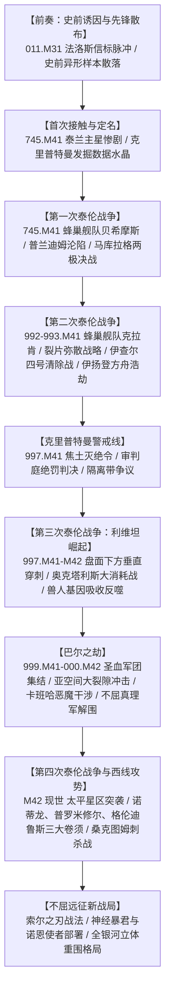

---

### 第2章 远古隐秘预兆与法洛斯信标事件（The Pharos Pulse）

* **时间坐标**：011.M31（荷鲁斯之乱时期）至 745.M41 之间 [Lexicanum] [官方: The Horus Heresy: Pharos]。
* **参战舰队与核心实体**：
  * 泰伦方：河外虚空中处于休眠状态的大吞噬者（The Great Devourer）母体集群 [Lexicanum]。
  * 帝国方：荷鲁斯之乱时期极限战士、火蜥蜴、钢铁勇士忠诚派连队（战争铁匠巴拉巴斯·丹提奥克指挥）[官方: The Horus Heresy: Pharos]。
* **过程梗概**：
  1. 荷鲁斯叛乱期间，极限星区为抗衡毁灭风暴（Ruinstorm），启用了索萨星（Sotha）地下的远古异形重定向装置——法洛斯信标（The Pharos）[Lexicanum]。
  2. 011.M31，午夜领主突袭索萨要塞。为防装置落入叛军之手，丹提奥克超载了信标核心。殉爆释放出超大功率量子灵能脉冲，冲破银河系引力屏障射向河外虚空 [Lexicanum] [官方: The Horus Heresy: Pharos]。
  3. 沉睡的大吞噬者被此道闪光唤醒，感知到银河系充沛的有机质，虫巢意志调转航向开始跨星系航行 [官方: The Horus Heresy: Pharos]。
* **结局与影响**：
  * 官方小说《荷鲁斯之乱：法洛斯》明确确立该脉冲是引来泰伦主力的终极物理诱因 [官方]。
  * **史前零星散落先兆【待考/争议】**：帝国在745.M41前记录的卡塔昌恶魔、芬里斯巨妖及M35发现的伊姆加尔基因窃取者，被部分生物学者推测为史前漂流至银河边缘的休眠样本；保守学派则视为本土异形趋同进化的独立巧合 [Lexicanum] [待考/争议]。

---

### 第3章 首次接触：泰兰主星惨剧与泰伦定名（The Fall of Tyran Primus）

* **时间坐标**：745.M41（帝国历 993745.M41）[Lexicanum] [官方: Codex: Tyranids (2nd Edition)]。
* **参战舰队与防守力量**：
  * 泰伦方：蜂巢舰队贝希摩斯先锋集群（Hive Fleet Behemoth）[Lexicanum]。
  * 帝国方：机械教勘探前哨站驻军、海洋防御要塞网与护卫舰分队 [Lexicanum] [官方: Codex: Tyranids (5th Edition)]。
* **过程梗概**：
  1. 机械教科研世界泰兰主星（Tyran Primus）突遭引力海啸袭击，随后亚空间阴影彻底切断星语通信 [Lexicanum]。
  2. 数以千计的几丁质空投囊扎入海洋要塞，生化毒雨迅速破坏生态，护教军退守深海地核防核地堡 [官方: Codex: Tyranids (2nd Edition)]。
  3. 泰伦强酸钻头生物数周内融穿地堡防爆门。覆灭前夕，指挥官将全过程解剖数据与全息录像封入最高加密等级的“数据水晶”（Datacrystal），深埋于火山基岩密封舱 [Lexicanum] [官方: Codex: Tyranids (5th Edition)]。
* **结局与影响**：
  * 泰兰主星被抽干大气与海洋，沦为死寂岩球 [Lexicanum]。
  * 审判官菲奥兰·克里普特曼（Inquisitor Kryptman）率队发掘出数据水晶，帝国首次确认这一外来掠食者。克里普特曼以该星球之名正式定名“泰伦（Tyranids）”，入侵舰队代号为“贝希摩斯”[Lexicanum] [官方: Codex: Tyranids (5th Edition)]。

---

### 第4章 第一次泰伦战争：贝希摩斯与马库拉格之战（First Tyrannic War）

* **时间坐标**：745.M41 [Lexicanum] [官方: Codex: Space Marines (5th Edition)]。
* **参战舰队与编制力量**：
  * 泰伦方：蜂巢舰队贝希摩斯主力母舰集群（万余艘生物战舰与数亿攻城生化兽）[Lexicanum]。
  * 帝国方：极限战士战团（战团长马纽斯·卡尔加统领，10个连队全员集结）、极限星区舰队、马库拉格轨道防御站网、奥特拉玛防卫军 [Lexicanum]。
* **过程梗概**：
  1. **普兰迪姆沦陷与全面收缩**：贝希摩斯以单一庞大矛头平推，连拔桑德罗斯星语站与贾加星，将奥特拉玛的花园明珠普兰迪姆（Prandium）夷为荒漠基岩球。卡尔加果断下令收缩力量，在母星马库拉格（Macragge）背水一战 [Lexicanum] [官方: Codex: Tyranids (5th Edition)]。
  2. **轨道虚空激战**：生物舰群顶着宏炮与光矛火网强行登舰撕咬，马库拉格轨道防御要塞逐一被生物孢子云瘫痪 [Lexicanum]。
  3. **冷钢山脊与群虫领主首现**：地表战区，虫巢意志现场实体化了其最高战术统帅——**群虫领主（The Swarmlord）** [Lexicanum] [官方: Codex: Tyranids (5th Edition)]。群虫领主突破防线并斩断卡尔加四肢，荣誉卫队长阿洛伊修斯率卫队全员死战阵亡，拼死抢回濒死的卡尔加 [Lexicanum]。
  4. **两极堡垒终结者绝唱**：极限战士第一连（100名终结者老兵，由连长阿格曼与长官因维克图斯统领）驻守南、北两极重型防御要塞以保卫轨道护盾。北极要塞遭海量巨兽饱和围攻，老兵背靠背结成圆阵搏杀至最后一人 [Lexicanum] [官方: Codex: Space Marines (5th Edition)]。
  5. **星辰之主号决死一击**：虚空战线崩溃之际，战列舰“星辰之主号（*Dominus Astra*）”冲入贝希摩斯核心引爆舰载亚空间引擎，引力坍缩撕开局部黑洞，将贝希摩斯主力吞噬殆尽 [Lexicanum] [官方: Codex: Space Marines (5th Edition)]。
* **结局与影响**：
  * 马库拉格得以保全，贝希摩斯主力覆灭；但极限战士第一连全灭，战团耗时逾百年方完成重建 [Lexicanum]。
  * 随军牧师卡修斯战后创立专司反突触斩首的**“泰伦战争老兵”（Tyrannic War Veterans）**编制，被各大战团广泛借鉴 [Lexicanum] [官方: Codex: Space Marines (8th Edition)]。

---

### 第5章 第二次泰伦战争：克拉肯扩散、伊查尔四号与伊扬登浩劫（Second Tyrannic War）

* **时间坐标**：992–993.M41 [Lexicanum] [官方: Codex: Tyranids (5th Edition)]。
* **参战舰队与多方阵营**：
  * 泰伦方：蜂巢舰队克拉肯（Hive Fleet Kraken）及数百支裂片小舰队 [Lexicanum]。
  * 帝国方：极限战士、帝皇之镰、哀恸者战团，帝国卫队数十个机械化兵团 [Lexicanum]。
  * 艾达灵族：伊扬登方舟世界（Craftworld Iyanden）、游侠王子伊瑞尔率领的艾达海盗舰队 [Lexicanum] [官方: Codex: Craftworlds (8th Edition)]。
* **过程梗概**：
  1. **战略突变：裂片弥散与多路渗透**：克拉肯改用宽逾数千光年的广域多路渗透，分裂为数百支裂片舰队实施游击包抄 [Lexicanum] [官方: Codex: Tyranids (5th Edition)]。
  2. **米拉尔主星之痛**：帝皇之镰母星索萨沦陷，残部撤至米拉尔主星“巨人之棺”玄武岩高地坚守，在狂潮围攻下近乎灭团，仅少数人生还 [Lexicanum] [官方: Codex: Space Marines (5th Edition)]。
  3. **伊查尔四号清除战（Battle of Ichar IV）**：制造厂世界伊查尔四号爆发潜伏已久的“四臂神皇教派”叛乱破坏防空 [Lexicanum]。卡尔加装配仿生义肢率队协同帝国卫队平叛，并在决斗中以极限之拳正面击斩群虫领主首级，瘫痪突触中枢肃清地表 [Lexicanum] [官方: Codex: Tyranids (5th Edition)]。
  4. **伊扬登方舟世界大浩劫（Battle of Iyanden）**：克拉肯主卷须合围繁荣的伊扬登方舟。平民死伤殆尽之际，先知被迫将阵亡者灵魂石植入幽冥护卫与幽冥领主骨架组成死者机械军团抵抗 [Lexicanum]。流亡海盗王子伊瑞尔率舰队杀回，拔出黄昏魔矛（Spear of Twilight）单骑击杀突触母皇，瓦解围攻 [Lexicanum] [官方: Codex: Craftworlds (8th Edition)]。
* **结局与影响**：
  * 伊扬登损失超过五分之四的族人，沦为由幽魂死者驻守的死寂方舟，灵族人口遭永久性重创 [Lexicanum]。
  * 克拉肯主力被碎，但海量裂片舰队逃逸繁衍，帝国随后数百年深陷漫长的清剿游击战 [Lexicanum] [官方: Codex: Tyranids (8th Edition)]。
  * 帝国确证基因窃取者教派与主力入侵的时空呼应机制，拉开全域严查异端教派序幕 [Lexicanum] [官方: Codex: Genestealer Cults]。

---

### 第6章 克里普特曼的焦土决策与警戒线争议（Kryptman's Scorched Earth & Cordon）

* **时间坐标**：997.M41 [Lexicanum] [官方: Codex: Tyranids (5th Edition)]。
* **核心实体**：异形审判庭高级审判官菲奥兰·克里普特曼、审判庭最高评议会、高领主议会 [Lexicanum]。
* **决策背景与实施梗概**：
  1. 997.M41，利维坦超级卷须从银河系底盘向上突穿，常规军事防御在数月内连环崩溃。
  2. 克里普特曼推论利维坦依赖沿途有机质增殖，逐星坚守只会为其提供无穷养料，必须彻底切断生物质补给链 [Lexicanum]。
  3. **焦土警戒线（Kryptman's Cordon）**：克里普特曼私调黑船舰队，在预测航道前方划定数十光年隔离带，使用旋风鱼雷与大气噬菌炸弹对沿线数十个帝国宜居世界执行无差别灭绝令（Exterminatus），数百亿未撤离的忠诚子民连同所有动植物化为灰烬，制造出绝对生命真空死带 [Lexicanum] [官方: Codex: Tyranids (5th Edition)]。
* **争议、结局与历史评价**：
  * **审判庭绝罚**：该残酷行径引发全帝国道德震怒。高领主议会与审判庭签发**“绝罚通缉令”（Carta Extremis）**，剥夺其一切职务与印信，将其定性为叛国屠夫并迫使其流亡 [Lexicanum] [官方: Codex: Tyranids (5th Edition)]。
  * **战术成效多方评价【待考/争议】**：激进派审判官指出焦土带迫使利维坦主力航向受阻并向两侧分流，为神圣泰拉赢得了关键备战窗口；保守派与阿斯塔特各团则谴责其白白耗尽帝国防卫人口与工业储备，且迫使卷须转向奥克塔利斯与巴尔，酿成更大危机 [Lexicanum] [官方: War Zone Octarius] [待考/争议]。

---

### 第7章 第三次泰伦战争：利维坦崛起与奥克塔利斯战争（Third Tyrannic War & Octarius War）

* **时间坐标**：997.M41 – 约 010.M42 [Lexicanum] [官方: War Zone Octarius] [官方: Codex: Tyranids (8th Edition)]。
* **参战舰队与交战方**：
  * 泰伦方：蜂巢舰队利维坦（Hive Fleet Leviathan）主卷须集群 [Lexicanum]。
  * 异形交战方：欧克塔利斯兽人帝国（Overfiend of Octarius）、碎骨者·嘎兹库尔大军及全银河响应集结的数万亿绿皮军团 [Lexicanum] [官方: War Zone Octarius]。
  * 幕后引诱方：流亡审判官克里普特曼及死亡守望杀戮小队 [Lexicanum]。
* **过程梗概**：
  1. **引狼入室之策**：流亡的克里普特曼率队捕获纯血基因窃取者，秘密投放到兽人帝国边境卡帕蒂星（Carpati）。高频繁殖产生的灵能信号成功将利维坦主卷须引诱转向奥克塔利斯 [Lexicanum] [官方: Codex: Tyranids (5th Edition)]。
  2. **兽人狂欢与百年血战**：全银河欧克兽人将入侵视为超级大乱斗疯狂涌入。绿皮越战越强，而泰伦不断将击毙兽人投入消化池转化为生化原浆，整个星区沦为持续数十年的活体筛选熔炉 [Lexicanum] [官方: War Zone Octarius: Book 1]。
  3. **终局反噬与兽人帝国覆灭（M42 终局战）**：至第十版不屈远征时期，利维坦研发出针对兽人真菌生理的靶向瘫痪毒素，斩杀新任兽人大军阀并彻底消化了奥克塔利斯主星 [Lexicanum] [官方: War Zone Octarius: Book 2 - Critical Mass]。
* **结局与影响**：
  * 驱虎吞狼之策彻底破产。兽人帝国从星图抹去，利维坦吸收强壮兽人的肌肉与骨骼基因后体量暴增，演化出骨甲更厚重、攻击更狂暴的特化重装攻城巨兽，全面杀向帝国腹地 [Lexicanum] [官方: War Zone Octarius]。

---

### 第8章 巴尔之劫：圣血军团绝唱、亚空间裂隙与原铸黎明（The Devastation of Baal）

* **时间坐标**：999.M41 – 000.M42（第四十一个千年终局与大裂隙降临交汇点）[Lexicanum] [官方: The Devastation of Baal (Novel)]。
* **参战舰队与军团编制**：
  * 泰伦方：蜂巢舰队利维坦巴尔攻巢卷须（集结近三万艘生物舰与数万亿突触军团）[Lexicanum]。
  * 帝国方：圣血天使战团及其近30个后继子团（近30,000名阿斯塔特，由统帅但丁任总指挥）[Lexicanum] [官方: The Devastation of Baal]。
  * 第三方混沌势力：恐虐恶魔军团（嗜血狂魔卡班哈统领）[Lexicanum]。
  * 帝国援军：摄政罗伯特·基里曼率领的不屈远征第一舰队（Fleet Primus）[Lexicanum]。
* **过程梗概**：
  1. **全血脉集结与阵地崩溃**：但丁在巴尔主星及双子卫星构筑防御阵地。利维坦生物舰撕碎轨道防御，地表堡垒逐一沦陷，血骑士等战团全员阵亡 [Lexicanum] [官方: The Devastation of Baal]。
  2. **双重宇宙突变（大裂隙与卡班哈）**：
     * 卡迪亚陷落引发大裂隙撕裂现实，暴走的亚空间风暴重创泰伦突触网络，大量生物舰被卷入虚无 [Lexicanum]。
     * 嗜血狂魔卡班哈率恐虐恶魔降临巴尔首席卫星，以“圣血之子头颅归血神所有”为由大肆屠戮虫群，在卫星地表堆砌出八座泰伦颅骨金字塔后隐退 [Lexicanum] [官方: The Devastation of Baal]。
  3. **不屈舰队解围与原铸新生**：风暴减弱之际，基里曼率不屈远征主力破空降临，以原铸星际战士军团的火力肃清残敌 [Lexicanum] [官方: The Devastation of Baal]。
* **结局与影响**：
  * 利维坦巴尔卷须被歼灭，圣血各团获得原铸阿斯塔特补齐编制；基里曼任命统帅但丁为**暗面帝国摄政王（Lord Regent of Imperium Nihilus）**，使巴尔成为暗面最高战略中枢 [Lexicanum] [官方: Codex: Blood Angels (8th Edition)]。

---

### 第9章 第四次泰伦战争与利维坦西线大攻势（Fourth Tyrannic War）

* **时间坐标**：M42 现世（第十版主线，不屈远征时代）[Lexicanum] [官方: Warhammer 40,000 (10th Edition)] [官方: Codex: Tyranids (10th Edition)]。
* **参战舰队与三大超级卷须**：
  * 泰伦方：利维坦重组集群，分化为**诺蒂龙（Nautilon）**、**普罗米修尔（Promethor）**及直插巴斯蒂奥星区的**格伦迪鲁斯（Grendyllus）** [Lexicanum] [官方: Warhammer 40,000 (10th Edition)]。
  * 帝国方：太阳领主阿卡迪安·莱昂图斯司令部、禁军统领图拉真·瓦洛里斯率领的禁卫军与寂静修女、各战团阿斯塔特混编部队 [Lexicanum]。
* **过程梗概**：
  1. **西线空虚与战略大迂回**：利维坦颠覆过往自东部或南部侵入的规律，前锋绕道至银河盘面西侧的**太平星区（Segmentum Pacificus）**突穿，矛头直指防卫空虚的神圣泰拉后背 [Lexicanum] [官方: Codex: Tyranids (10th Edition)]。
  2. **格伦迪鲁斯卷须刺入巴斯蒂奥星区**：格伦迪鲁斯超级卷须撕开巴斯蒂奥星区，数十个工业世界陷落，泰拉紧急调遣太阳星区常备军与禁军出征筑墙 [Lexicanum] [官方: Warhammer 40,000 (10th Edition)]。
  3. **桑克图姆围攻战与诺恩刺杀行动**：在要塞世界桑克图姆，诺恩虫后投放终极刺杀生物**诺恩使者（Norn Emissary）**对帝国统帅部实施斩首。诺恩使者格杀多名禁卫与军官，直扑太阳领主莱昂图斯；危急时刻禁军统领图拉真手持守望长矛亲率卫队突杀，阵前劈碎诺恩使者颅骨，保全了帝国统帅 [Lexicanum] [官方: Leviathan Box Set Lore] [官方: Codex: Tyranids (10th Edition)]。
* **结局与影响**：
  * 彻底打破神圣泰拉的安全屏障，常年留守泰拉的禁军首次成建制奔赴深空作战，基里曼不得不调配不屈远征核心资源构筑西线防线 [Lexicanum] [官方: Warhammer 40,000 (10th Edition)]。

---

### 第10章 不屈远征时期最新战术演进与全域围困格局（Indomitus Era Developments）

面对第四次泰伦战争的严峻形势，双方在不屈远征时代展开了多维度的战术对抗 [Lexicanum] [官方: Warhammer 40,000 (10th Edition)]：

#### 10.1 索尔之刃战法（The Solblades Fleets）
* **机制与目标**：放弃静态逐星防御，帝国高层组建多支由战列舰、打击巡洋舰与机械教方舟构成的**“索尔之刃”（Solblades）**特遣混编舰队 [Lexicanum]。
* **战术模式**：索尔之刃舰队作为高机动虚空手术刀，穿透外围炮灰网络，利用亚空间微跳跃直插利维坦中军腹地，定向轰杀突触中枢母舰。母脑被灭后周边低阶虫群便会陷入本能行为退化而自相残杀，为后方争取防御重组时间 [Lexicanum] [官方: Codex: Tyranids (10th Edition)]。

#### 10.2 第十版特化生化武器对抗
* **神经暴君（Neurotyrant）**：浮空灵能中继母体，全面放大战区亚空间阴影共鸣，释放烧穿星语者神经的心灵风暴 [Lexicanum]。
* **灵能噬魂兽（Psychophage）**：特化消化灵能者法术，将亚空间能量转化为生化强酸反喷敌阵 [Lexicanum] [官方: Warhammer 40,000 (10th Edition)]。
* **前哨刺杀群**：大量部署**冯·赖安跳跃者（Von Ryan's Leapers）**与**野蛮虫（Barbgaunts）**，专门猎杀星际战士火力小组与斥候 [Lexicanum]。

#### 10.3 全银河立体合围态势
至战锤40K现世，泰伦虫族已在**南（利维坦早期卷须）、东（贝希摩斯与克拉肯余脉、提亚玛特信标）、西（第四次泰伦战争三大超级卷须）三面完成战略合围** [Lexicanum]。神圣泰拉的星炬光芒持续吸引着深空中未知规模的庞大母体向银河系聚拢 [Lexicanum]。

---

### 第11章 重大战役全要素对照表（Major Campaigns Summary）

| 战役名称 | 历法时间坐标 | 参战虫巢舰队 | 帝国与异族参战编制 | 决胜关键点 / 终局手段 | 战术与战略影响 | 核心文献依据 |
| :--- | :--- | :--- | :--- | :--- | :--- | :--- |
| **泰兰主星惨剧** | 745.M41 | 贝希摩斯先锋 | 机械教勘探前哨站驻军 | 强酸钻头融穿地核地堡，守军覆没 | 行星退化为死寂基岩球；克里普特曼定名“泰伦” | [Lexicanum] [官方: Codex (5th)] |
| **马库拉格之战** | 745.M41 | 贝希摩斯主力 | 极限战士全军、星区舰队 | 战列舰“星辰之主号”引爆亚空间引擎形成黑洞自爆 | 贝希摩斯覆灭；一连终结者全员阵亡；创立泰伦战争老兵 | [Lexicanum] [官方: Codex (5th)] |
| **伊查尔四号战役** | 993.M41 | 克拉肯核心卷须 | 极限战士主力、帝国卫队兵团 | 卡尔加单挑击斩群虫领主首级，瘫痪指挥 | 粉碎四臂神皇教派叛乱；确证基因窃取者教派协同机制 | [Lexicanum] [官方: Codex (5th)] |
| **伊扬登方舟浩劫** | 993.M41 | 克拉肯裂片群 | 艾达灵族伊扬登、伊瑞尔海盗 | 伊瑞尔拔出黄昏魔矛单骑击杀突触母皇 | 伊扬登丧失五分之四族人沦为幽魂方舟；灵族人口遭暴跌 | [Lexicanum] [官方: Codex (8th)] |
| **焦土警戒线实施** | 997.M41 | 利维坦中路 | 审判庭黑船舰队（克里普特曼） | 沿线数十个帝国世界被旋风鱼雷灭绝令彻底摧毁 | 人工制造数十光年生命死带；克里普特曼遭绝罚通缉 | [Lexicanum] [官方: Codex (5th)] |
| **奥克塔利斯大消耗战** | 997.M41–010.M42 | 利维坦主卷须 | 兽人帝国、嘎兹库尔大军、死亡守望 | 利维坦研发针对兽人真菌黏膜的定向毒素斩首军阀 | 兽人帝国覆灭；利维坦吸收绿皮基因完成狂暴进化 | [Lexicanum] [官方: War Zone Octarius] |
| **巴尔之劫** | 999.M41–000.M42 | 利维坦巴尔卷须 | 圣血天使及各子团、卡班哈恶魔、基里曼第一舰队 | 大裂隙重创突触网；卡班哈屠虫立塔；基里曼携原铸解围 | 击退利维坦；圣血天使获原铸新生；但丁出任暗面摄政王 | [Lexicanum] [官方: Devastation of Baal] |
| **桑克图姆围攻战** | M42 现世 | 利维坦格伦迪鲁斯 | 太阳领主司令部、禁军图拉真、各战团 | 图拉真手持守望长矛阵前劈裂诺恩使者颅骨 | 挫败统帅部斩首企图；促使帝国启动“索尔之刃”战术 | [Lexicanum] [官方: 10th Rulebook] |

---

---

## 第三编 生物图鉴

### 第1章 生物形态功能分工总览

泰伦虫族不依靠固定物种繁衍，所有生物体本质上均属于虫巢意志为了填补特定生态位而定制的**“生物武器平台”（Biomorphs）** [Lexicanum]：

| 生态位分类 | 代表生物（中文名 / 英文名） | 突触状态 | 解剖学特征与战术生态功能 | 来源标注文献 |
| :--- | :--- | :--- | :--- | :--- |
| **侦察与渗透** *(Infiltration & Scouting)* | **纯血基因窃取者** (*Purestrain Genestealer*) | 非突触 (可脱离母网) | 拥有坚硬的金刚石硬度撕裂爪（Rending Claws）与独立智能脑，善于在狭窄空间潜伏突袭，行使“基因窃取者之吻”感染猎物。 | [Lexicanum] [官方: Codex: Tyranids (8th)] |
| | **李克特** (*Lictor*) | 非突触 (自主潜行) | 变色龙外皮可与任何环境完美共鸣隐形，配备大型捕食螳螂臂与头部长须状喂食触须，用于刺探情报与潜伏引导。 | [Lexicanum] [官方: Codex: Tyranids (9th)] |
| **突击与集群近战** *(Assault & Swarm)* | **霍玛冈特** (*Hormagaunt*) | 非突触 (需近程突触引导) | 极廉价的跳跃冲击兵种，后腿具备强韧肌腱弹跳力，双臂特化为骨质长镰，凭借排山倒海的数量冲垮防线。 | [Lexicanum] [官方: Codex: Tyranids (5th)] |
| | **飞天虫群 / 翼手虫** (*Gargoyle*) | 非突触 | 背部长有膜质皮翼的轻型近战/骚扰单位，善于喷吐弱酸与火焰，遮蔽守军防空视野与掩护地面主力。 | [Lexicanum] [官方: Codex: Tyranids (8th)] |
| **远程火力压制** *(Ranged Firepower)* | **泰马冈特** (*Termagant*) | 非突触 | 小型远程步兵，共生搭载**钻脑铳（Fleshborer）**，发射带有活体寄生甲虫卵的几丁质弹丸，射入目标体内后甲虫会疯狂啮咬脑神经。 | [Lexicanum] [官方: Codex: Tyranids (8th)] |
| | **外分泌生化炮兽** (*Exocrine*) | 非突触 | 重装甲重型生化自行火炮，背负多联生物等离子发射管，能够高射速抛射高温腐蚀性等离子体，专门瓦解重型装甲与掩体。 | [Lexicanum] [官方: Codex: Tyranids (6th)] |
| | **生化炮兽** (*Biovore*) | 非突触 | 笨拙的活体迫击炮台，体内孕育并曲射抛掷活体孢子地雷（Spore Mines），封锁战场通道。 | [Lexicanum] [官方: Codex: Tyranids (4th)] |
| **重型攻城与泰坦** *(Heavy Siege & Titans)* | **刽子手 / 盲眼巨兽** (*Carnifex*) | 非突触 | “活体攻城破城槌”，重达数吨的高密度骨骼装甲，配备巨钳、骨锤尾或镰刀爪，在冲锋中直接砸碎要塞金属防爆门。 | [Lexicanum] [官方: Codex: Tyranids (5th)] |
| | **贪食兽** (*Haruspex*) | 非突触 | 专门用于突破战壕与碉堡的清道夫巨兽，胸前长有由密密麻麻倒钩触手构成的开花式吞噬大口，能将敌军整批吞入腹中强酸囊。 | [Lexicanum] [官方: Codex: Tyranids (6th)] |
| | **圣教徒生化泰坦** (*Hierophant Bio-Titan*) | 突触抗性节点 | 高达数十米的四足巨兽，装配重型生物酸液喷射器与集群杀伤囊，其几丁质外壳足以硬抗战将级帝国泰坦的主炮轰击。 | [Lexicanum] [官方: Imperial Armour IV] |
| **灵能节点** *(Psychic Nodes)* | **佐安索普** (*Zoanthrope*) | 强突触节点 | 大头、萎缩下肢的悬浮灵能单位，由灵族基因培育而来。能投射坚不可摧的亚空间护盾，并汇聚灵能投射毁灭性的灵能长矛（Warp Blast）。 | [Lexicanum] [官方: Codex: Tyranids (5th)] |
| | **神经暴君** (*Neurotyrant*) | 核心级灵能突触 | 第十版新增指挥级灵能母体，如同漂浮的心灵水母，专职放大全战区的亚空间阴影共鸣，向敌军脑内灌输神经瘫痪狂潮。 | [Lexicanum] [官方: Warhammer 40,000 (10th)] |
| **战术指挥节点** *(Command Synapse)* | **泰伦武士** (*Tyranid Warriors*) | 战术中继突触 | 战术军官级生物，身高约3米，多才多艺，可同时搭载骨剑、近战镰刀与死亡绞杀炮，充当底层部队的突触控制中枢。 | [Lexicanum] [官方: Codex: Tyranids (8th)] |
| | **虫巢暴君** (*Hive Tyrant*) | 高级统驭突触 | 战役指挥核心，体魄强健且具备独立高等智力与战术推演能力；其特殊变体**群虫领主（The Swarmlord）**拥有数万年对抗全银河文明的作战记忆与轮回转生特权。 | [Lexicanum] [官方: Codex: Tyranids (5th)] |
| | **诺恩使者** (*Norn Emissary*) | 终极意志突触 | 诺恩虫后亲手定制的终极生化杀手，体型超越虫巢暴君，结合了无匹的物理抗性与心灵灭杀能力，专为刺杀敌方战略统帅而生。 | [Lexicanum] [官方: Warhammer 40,000 (10th)] |
| **生态消化与回收** *(Digestion & Reclamation)* | **吞噬虫群** (*Ripper Swarm*) | 盲目非突触 | 类似小蛇或幼虫的细小生物，拥有锋利的下颚骨与强韧胃袋，成群吞噬有机物后投入消化池，是生物质回收的最底层工人。 | [Lexicanum] [官方: Codex: Tyranids (5th)] |
| | **噬腐兽** (*Malanthrope*) | 辅助突触采集 | 漂浮在战场上空的采样生物，利用腹部触手收集高价值击杀目标（如敌军英雄、稀有异形）的完好基因，带回母舰分析。 | [Lexicanum] [官方: Imperial Armour IV] |

---

---

### 第2章 指挥与突触生物（Command & Synapse Creatures）

此类生物是虫巢意志在物理宇宙的神经投影节点与战术中枢，维系虫群秩序并向外辐射强烈的亚空间阴影。

#### 2.1 虫巢暴君（Hive Tyrant）
* **体型量级**：双足/多肢超重型怪兽（Monstrous Creature）。原典记载直立高约 6 至 7 米（约 20-25 英尺），重数吨，体格数倍于阿斯塔特修士，覆有多层致密几丁质复合装甲 [Lexicanum] [官方: Codex: Tyranids (5th Edition)]。
* **生态位**：最高战场统御中枢与战役决策母体。承接虫巢母舰宏观战略，具备独立人格化战场运算与战术推演能力 [Lexicanum]。
* **标志性武器/器官**：
  * **生化近战兵装**：搭载骨剑（Boneswords，内具高频神经灵能脉冲回路，可撕裂陶钢）与高韧性骨鞭（Lashwhip，封锁敌方近战动作）[Lexicanum] [官方: Codex: Tyranids (8th Edition)]。
  * **共生重火炮**：可选装重型生化毒炮（Heavy Venom Cannon）或倒钩绞杀炮（Stranglethorn Cannon）[Lexicanum]。
  * **飞天变体（Winged Hive Tyrant）**：附肢特化为翼展逾 12 米的革质皮翼，行使低空俯冲战术 [官方: Codex: Tyranids (6th Edition)]。
* **行为特征**：拥有极高战场洞察力，擅于即时调整各虫种进攻节奏。其战术记忆在阵亡后会被母舰孕育池完整回收重组（最高变体为累积数万年战争经验的群虫领主 The Swarmlord）；其死亡会引发局部突触震荡（Synaptic Backlash），导致周围低阶生物陷入短暂混乱 [Lexicanum] [官方: Codex: Tyranids (5th/8th Edition)]。

#### 2.2 暴君近卫（Tyrant Guard）
* **体型量级**：特化重甲无眼无突触怪兽。肩高约 3 至 4 米，体态佝偻粗壮，重逾数吨，皮下覆有相互嵌合的高密度骨板 [Lexicanum] [官方: Codex: Tyranids (4th Edition)]。
* **生态位**：专职活体肉盾与暴君近身卫队。非突触生物，唯一生理驱动为承受反装甲火力以庇护突触领袖 [Lexicanum]。
* **标志性武器/器官**：
  * **复合盾爪与撕裂钳**：前肢发育为兼具护盾功能的撕裂盾爪（Rending Claws）或巨力撕裂螯钳（Crushing Claws），外壳足以抵御穿甲激光与高爆直击 [Lexicanum]。
  * **黑色甲壳同源装甲**：骨板微观结构呈现与阿斯塔特星际战士“黑色甲壳”高度近似的致密蜂窝晶体与骨化纤维网络 [Lexicanum] [官方: Codex: Tyranids (4th Edition)]。
  * **退化感官**：双眼完全退化为骨质封闭，依靠化学触须、震动与突触感应定位敌情 [Lexicanum]。
* **行为特征**：其神经反射被硬连线为“绝对牺牲”，会自发横移拦截反物质光束或弹丸 [Lexicanum]。当所护卫的暴君阵亡时，受突触骤断与激素剧变驱使，近卫不仅不溃逃，反而会爆发**盲目狂暴状态（Blind Fury）**，不顾致命重创疯狂绞杀周围一切活物直至死亡 [官方: Codex: Tyranids (5th Edition)]。

#### 2.3 诺恩使者（Norn Emissary）
* **体型量级**：超巨型 Apex 突触怪兽。直立高达 10 至 12 米，体量远超虫巢暴君，逼近小型帝国泰坦，覆有带神经荧光的重型几丁质骨板 [Lexicanum] [官方: Warhammer 40,000 (10th Edition)]。
* **生态位**：诺恩虫后亲手定制的战略级单体定点斩首刺客与终极突触节点 [Lexicanum]。
* **标志性武器/器官**：
  * **灵能脑电神经冠（Cerebral Crest）**：头部高耸的灵能聚能骨冠，可抽取亚空间能量投射撕裂装甲与灵魂的“神经长矛（Neuro-spears）”与亚空间爆裂力场 [官方: Codex: Tyranids (10th Edition)]。
  * **四足两臂撕裂巨刃**：前肢配备坚固度超越动力武器的超重型撕裂镰爪，可徒手撕开兰德袭击者重型坦克前装甲 [Lexicanum]。
  * **胸部反步兵神经刺**：前胸排布神经毒液喷射孔，用以清理近身杂兵 [官方: Codex: Tyranids (10th Edition)]。
* **行为特征**：受**单一天命机制（Singular Purpose）**驱动。母舰出舱时已被固化唯一目标（如刺杀战区总司令或夺取古代神物）；推进中无视任何火力拦截，曾突破桑克图斯防线强杀禁军与极限战士指挥部；具备仅次于虫后的突触优先级，免疫常规灵能干扰 [Lexicanum] [官方: Warhammer 40,000 (10th Edition)]。

#### 2.4 诺恩同化者（Norn Assimilator）
* **体型量级**：超重型物理攻坚巨兽。体量与诺恩使者等同（直立高约 10 至 12 米），通体覆盖极度加厚的实心装甲板，无凸出灵能脑冠 [Lexicanum] [官方: Codex: Tyranids (10th Edition)]。
* **生态位**：坚固工事破坏者、敌方泰坦/重甲据点强拆矛头与高价值生物质捕获平台 [Lexicanum]。
* **标志性武器/器官**：
  * **毒素注射索钩（Tox-injector Harpoons）**：肩胸部生有巨大骨质飞叉，连接超高强度肌腱。命中敌方重型载具或巨兽后注入速效溶解毒液，并利用肌腱绞盘强行拖至身前 [官方: Codex: Tyranids (10th Edition)]。
  * **重装同化撕裂镰（Assimilator Talons）**：前肢配备沉重实心几丁质巨镰，专职砸碎工事混凝土与泰坦外甲 [Lexicanum]。
* **行为特征**：摒弃灵能手段，纯以极致动能推进。在攻城战中将坦克或外墙支柱发射索钩强行扯塌，近距将其砸碎后立即启动吻管实施初步生化液化，为后续虫潮标定高浓度养分点 [Lexicanum] [官方: Codex: Tyranids (10th Edition)]。

#### 2.5 脑虫 / 佐安索普（Zoanthrope）
* **体型量级**：中型悬浮灵能怪兽。全长约 2.5 至 3 米，下肢严重萎缩，头颅及角质颅骨占全身质量三分之二以上 [Lexicanum] [官方: Codex: Tyranids (5th Edition)]。
* **生态位**：强突触中继节点、战场反重装甲灵能火炮平台 [Lexicanum]。
* **标志性武器/器官**：
  * **巨化灵能脑髓**：吸收艾达灵族（Aeldari）基因演化而成的复合神经中枢，内含高效亚空间回路 [Lexicanum] [官方: Codex: Tyranids (3rd Edition)]。
  * **亚空间长矛（Warp Blast / Warp Lance）**：汇聚虫巢意志灵能投射高能毁灭光束，可分子级离解重甲坦克 [Lexicanum]。
  * **亚空间屏障（Warp Field）**：周身环绕强韧灵能力场，防护性能媲美帝国铁光环，能抵御重炮直击 [官方: Codex: Tyranids (8th Edition)]。
* **行为特征**：全程反重力悬浮移动。常以 3 至 6 只为群落协同，在群体间共享亚空间回路与灵能储备（Spirit Leech），数量越多长矛威力越大；过载时有自爆风险 [官方: Codex: Tyranids (8th Edition)]。其极端个体“玛兰泰的覆灭（Doom of Malan'tai）”曾吞噬灵族方舟数百万灵魂并摧毁整个方舟世界 [Lexicanum] [官方: Codex: Tyranids (5th Edition)]。

#### 2.6 神经虫（Neurogaunt / 神经冈特）
* **体型量级**：微型四足突触共生步兵群。肩高约 0.8 至 1 米，体长约 1.2 米，体重数十千克，行动极敏捷 [Lexicanum] [官方: Warhammer 40,000 (10th Edition)]。
* **生态位**：活体突触传导线（Synaptic Conduit）与灵能母体贴身肉盾 [官方: Codex: Tyranids (10th Edition)]。
* **标志性武器/器官**：
  * **背部共生神经囊（Neurocyte Symbiote）**：背甲寄生的海绵状神经瘤，与宿主神经融合，充当微型灵能天线放大并中继突触信号 [官方: Codex: Tyranids (10th Edition)]。
  * **微型爪刃与利齿**：仅具基础自卫近战前肢，无远程武器 [Lexicanum]。
* **行为特征**：以数十只为群簇拥在神经暴君（Neurotyrant）或佐安索普身侧，在战场张开突触网络导线，大幅扩张前线兵虫的突触受控半径；遭遇火力时会肉身挡弹；一旦神经囊损毁或与突触主脑失联，缺乏进攻本能的神经虫会立即陷入惊恐溃逃 [官方: Codex: Tyranids (10th Edition)]。*(注：本种专指微型中继小虫，区别于指挥级神经暴君与精锐灵能脑虫头神经毒兽 Neurothrope)*。

---

### 第3章 步兵与突击生物（Infantry & Assault Creatures）

步兵与突击集群是泰伦陆战进攻波次的骨干，依靠惊人数量、极高移动速度与多样共生武器实施穿插、消耗与阵地撕裂。

#### 3.1 泰伦武士（Tyranid Warriors）
* **体型量级**：中大型突触重装步兵。直立身高约 2.4 至 3 米（8-10 英尺），重约 1 吨，解剖学具备三对多关节对称附肢 [Lexicanum] [官方: Codex: Tyranids (5th Edition)]。
* **生态位**：基层战场指挥官与战术突触支柱，阵地穿插与步火协同轴心 [Lexicanum]。
* **标志性武器/器官**：
  * **多模块附肢配置**：可配装近战骨剑、撕裂双镰或骨鞭；亦可共生接合远程火器 [Lexicanum]。
  * **中口径生化枪炮**：包括喷射寄生幼虫的吞噬者枪（Devourer）、酸液射弹的死亡绞杀枪（Deathspitter），以及班组级毒液加农炮（Venom Cannon）与绞肠炮（Barbed Strangler）[官方: Codex: Tyranids (8th Edition)]。
* **行为特征**：具备连排级战术推演智谋，能协调不同虫群实施交叉掩护与两翼包抄。其身侧数十米内低阶兵虫完全免疫恐慌与本能溃退；武士濒死时仍会执行神经反射反扑 [Lexicanum] [官方: Codex: Tyranids (8th/9th Edition)]。

#### 3.2 基因窃取者（Purestrain Genestealers）
* **体型量级**：快速渗透近战步兵。站立高约 1.8 至 2 米，重约 150 至 200 千克，肌肉爆发力远超常人 [Lexicanum] [官方: Codex: Tyranids (8th Edition)]。
* **生态位**：先锋潜伏刺客、舰内狭小空间撕裂者与先导教派播种源 [Lexicanum]。
* **标志性武器/器官**：
  * **金刚石级撕裂爪（Rending Claws）**：上方一对前肢长有分子级致密爪刃，原典证实可轻松切开阿斯塔特动力甲陶钢与终结者精金装甲 [Lexicanum] [官方: Space Hulk Rulebook]。
  * **产卵吻管（Genestealer's Kiss）**：下颚伸缩针管，能将异形遗传物质注入宿主神经系统 [Lexicanum] [官方: Codex: Genestealer Cults (8th Edition)]。
* **行为特征**：脱离母舰网络时依靠局部巢群心智（Broodmind）自主运作；可在太空废船真空与极寒中假死休眠数百年；肉搏反应为微秒级；优先通过感染宿主繁衍四代杂交后代，建立潜伏教派策应主力降临 [Lexicanum] [官方: Codex: Genestealer Cults (9th Edition)]。

#### 3.3 刀虫 / 霍玛冈特（Hormagaunts）
* **体型量级**：轻型四足跳跃冲锋兵。体长约 2 米（含细长配重尾），肩高约 1.2 至 1.5 米，骨骼中空轻量化 [Lexicanum] [官方: Codex: Tyranids (5th Edition)]。
* **生态位**：超廉价近战自杀冲锋群、战壕防线突破者与火力消耗品 [Lexicanum]。
* **标志性武器/器官**：
  * **前肢双镰（Scything Talons）**：前肢骨化为长近一米的锋利弯刀状几丁质硬刃 [Lexicanum]。
  * **高弹性后肢**：多重反关节肌肉结构，单次跃进跨度数米，能轻松跃过铁丝网与堑壕拒马 [Lexicanum] [官方: Codex: Tyranids (8th Edition)]。
* **行为特征**：单兵寿命短暂，以数十万计规模集团冲锋。具备战场前线自生卵生殖能力（腹部未受精卵排入土壤数小时即可孵化成虫）；一旦突触中断立即退化为“进食本能”，无脑扑咬就近活物或啃食尸体，丧失战术协调 [Lexicanum] [官方: Codex: Tyranids (3rd/8th Edition)]。

#### 3.4 枪虫 / 泰马冈特（Termagants）
* **体型量级**：轻型远程压制步兵。体长约 2 米，肩高约 1 米，呈驼背低趴身姿 [Lexicanum] [官方: Codex: Tyranids (5th Edition)]。
* **生态位**：中短程交火步兵、阵地前哨火力试探与掩护幕墙 [Lexicanum]。
* **标志性武器/器官**：
  * **钻脑铳（Fleshborer）**：与前肢永久共生的活体枪械，内部秒级孵化具有钻头硬壳的活体钻脑甲虫（Borer Beetles）；发射后甲虫高速钻入猎物肌肉疯狂啃食神经中枢致其暴毙 [Lexicanum] [官方: Codex: Tyranids (8th Edition)]。
  * **突变枪械**：亦可装配高射速刺脊枪（Spinefist）或射程更远的吞噬者枪（Devourer）[官方: Codex: Tyranids (10th Edition)]。
* **行为特征**：受突触引导时依托弹坑实施密集齐射；但其动物心智极度怯懦，突触信号中断后会立刻触发“潜伏本能”，逃窜躲入废墟裂隙自保，仅被动攻击接近者 [Lexicanum] [官方: Codex: Tyranids (8th Edition)]。

#### 3.5 石像鬼 / 翼手虫（Gargoyles）
* **体型量级**：轻型飞行突击兵。翼展约 2 至 3 米，体长约 1.5 米，蜂窝气孔骨骼大幅减轻自重 [Lexicanum] [官方: Codex: Tyranids (4th Edition)]。
* **生态位**：低空骚扰、要塞防空火力饱和遮蔽与阵地俯冲打击者 [Lexicanum]。
* **标志性武器/器官**：
  * **宽大翼膜与喷气孔**：背部革质皮膜翼配合腹侧气体喷射孔进行空中悬停与极速变向 [Lexicanum]。
  * **酸液喷吐与钻脑铳**：喉部毒腺可喷射灼热强酸致盲炮手，下肢悬挂钻脑铳实施扫射 [官方: Codex: Tyranids (8th Edition)]。
* **行为特征**：解剖学为枪虫的空战近亲。常伴随孢子云大群俯冲掩蔽地面部队，致盲防空雷达与炮位；脱离突触后盘旋至高耸建筑顶部筑巢，对领空进入者实施本能自卫扑咬 [Lexicanum] [官方: Codex: Tyranids (5th Edition)]。

---

### 第4章 重型与攻城生物（Heavy & Siege Creatures）

此类生物是泰伦陆军的活体装甲部队与重攻城平台，具备强韧弹道抗性与强拆能力，专职撕裂重装甲、要塞堡垒与防空体系。

#### 4.1 刽子手 / 卡尼菲克（Carnifex）
* **体型量级**：超重型活体攻城破门槌。高约 4.5 至 5 米，重达 8 至 10 吨，体表覆有数英尺厚的复合几丁质外骨骼，能承受常规穿甲反坦克直击 [Lexicanum] [官方: Codex: Tyranids (5th Edition)]。
* **生态位**：硬质据点粉碎机、装甲突穿先锋与阵线破障中坚 [Lexicanum]。
* **标志性武器/器官**：
  * **撞击撕裂肢体**：装配巨型撕裂螯钳（Crushing Claws，可夹碎黎曼鲁斯特战坦克）或粉碎镰爪 [Lexicanum]。
  * **经典变体构型**：
    * **尖啸杀手（Screamer-Killer）**：声带高频震颤发出使步兵致聋吐血的声波尖啸，口部喷吐超高温生物等离子体球（Bio-plasma）[Lexicanum] [官方: Codex: Tyranids (3rd/10th Edition)]。
    * **远程重炮型**：搭载重型毒液炮或绞杀炮充当活动生化炮台 [官方: Codex: Tyranids (8th Edition)]。
  * **尾锤（Bone Mace / Thresher Scythe）**：尾部骨化为流星锤扫除后方步兵 [Lexicanum]。
* **行为特征**：冲锋时数十吨动能可直接撞穿混凝土防爆闸门；神经迟钝粗糙，承受多处致命伤仍能凭惯性前冲；非突触生物，突触断开后会爆发生死不顾的狂暴碾压本能，甚至踩踏友军兵虫 [Lexicanum] [官方: Codex: Tyranids (5th Edition)]。

#### 4.2 生化炮兽 / 活体迫击兽（Biovore）
* **体型量级**：中重型生化曲射炮兽。体长约 3.5 米，肩高约 2.5 米，体型扁平，四肢粗大呈爪状 [Lexicanum] [官方: Codex: Tyranids (4th Edition)]。
* **生态位**：超远程曲射火力压制、防线阻滞与战区活体雷区散布者 [Lexicanum]。
* **标志性武器/器官**：
  * **背部迫击炮膛（Spore Mine Launcher）**：与脊椎完全一体化的肉质发射管，具强力括约肌与高压气体膨胀囊 [Lexicanum]。
  * **兽人同源育卵腔**：融合欧克真菌遗传特性，可在体内快速合成浮空**孢子地雷（Spore Mines）**与第十版**神经寄生雷（Neuroparasites）** [Lexicanum] [官方: Codex: Tyranids (4th/10th Edition)]。
* **行为特征**：行动蹒跚。驻定后四肢爪刃深扎地面吸收巨大后坐力，以高仰角将孢子地雷抛射至数公里外；地雷在目标空域滞空并自动向活体热源漂移自爆，强行封锁行军通道；脱离突触后原地呆滞，仅机械性自卫 [Lexicanum] [官方: Codex: Tyranids (10th Edition)]。

#### 4.3 雄蜂兽 / 灵脑雄蜂兽（Maleceptor）
* **体型量级**：超重型灵能装甲巨兽。体长约 6 至 7 米，肩高约 4.5 米，体重十余吨，六足爬行，全身覆有重型角质硬甲 [Lexicanum] [官方: Codex: Tyranids (7th Edition)]。
* **生态位**：前线重装灵能突击堡垒、亚空间灵能风暴发射塔与反灵能压制核心 [Lexicanum]。
* **标志性武器/器官**：
  * **外露双叶灵能巨脑（Encephalic Cortex）**：前半身生有一对受角质外壳半包裹的硕大灵能大脑，表面血管与灵能神经流光脉动 [Lexicanum] [官方: Codex: Tyranids (8th Edition)]。
  * **灵能过载震荡（Psychic Overload）**：将亚空间阴影杂音汇聚为定向冲击波，直击敌脑髓致步兵暴毙，并使车载电子机魂过载烧毁 [官方: Codex: Tyranids (10th Edition)]。
  * **重装前镰爪**：厚重骨刃用于近身肉搏防卫 [Lexicanum]。
* **行为特征**：作为亚空间阴影在地面的攻坚具象，无视普通反坦克火力缓步推线；所过之处数十米内敌军灵能者遭受爆头级灵能反噬；其强韧突触能稳固整个战线的低等虫潮士气 [Lexicanum] [官方: Codex: Tyranids (8th/10th Edition)]。

#### 4.4 毒液兽 / 毒雾索普（Venomthrope）
* **体型量级**：中型悬浮生化辅助怪兽。长约 2.5 米，下肢萎缩为软体组织，腹部悬挂多条两米余长的剧毒触手 [Lexicanum] [官方: Codex: Tyranids (5th Edition)]。
* **生态位**：战场战术移动烟幕屏障、生化气溶胶毒化者与步兵冲锋掩护者 [Lexicanum]。
* **标志性武器/器官**：
  * **背部排毒烟囱（Spore Chimneys）**：排布数根角质烟管，秒级喷涌黄绿色致命孢子云与腐蚀性气溶胶 [Lexicanum] [官方: Codex: Tyranids (8th Edition)]。
  * **神经剧毒触须（Poison Tentacles）**：密布刺细胞，分泌接触即致死的瘫痪神经毒素 [官方: Codex: Tyranids (8th Edition)]。
  * **代谢气体浮囊**：体内低密度气囊维持其悬浮滑行 [Lexicanum]。
* **行为特征**：随步兵群浮空推进，其制造的厚重毒云不仅令吸入者肺泡瞬间坏死液化，更能有效偏转激光、红外热像与实弹弹道，为冲锋虫潮构筑天然掩护掩体；近战时触须缠绕麻痹强敌 [Lexicanum] [官方: Codex: Tyranids (5th/8th Edition)]。

---

### 第5章 支援与生产生物（Support & Production Creatures）

此类生物负责战场即时兵员繁育孵化、前线阵地防御固化与局部微生态快速改造。

#### 5.1 子宫兽 / 特维冈（Tervigon）
* **体型量级**：超重型母巢指挥巨兽。肩高逾 6 米，全长超 8 米，重数十吨，腹部膨大下垂呈巨型肉质囊肿 [Lexicanum] [官方: Codex: Tyranids (5th Edition)]。
* **生态位**：前线移动步兵孵化母体、战地兵源永续供给中枢与强突触指挥官 [Lexicanum]。
* **标志性武器/器官**：
  * **生化育婴腹囊（Gestation Sac）**：富含高能营养液的活体孕育工厂，可在体内高速催熟预制枪虫胚胎 [Lexicanum] [官方: Codex: Tyranids (5th Edition)]。
  * **撕裂巨镰 / 巨爪与骨矛**：粗壮前足可压碎装甲载具，背部可搭载集束生化棘刺 [Lexicanum] [官方: Codex: Tyranids (8th Edition)]。
* **行为特征**：在交火前沿伴随推进，能以肌肉剧烈收缩在**战斗中每分钟现场分娩数十只成熟枪虫（Termagants）**，使前线进攻波次无穷无尽；但若其腹囊被重炮贯穿引爆，会诱发剧烈的**突触猝死反噬（Synaptic Feedback）**，导致身旁其产出的枪虫大脑当场过载暴毙 [Lexicanum] [官方: Codex: Tyranids (5th/10th Edition)]。

#### 5.2 卵鞘兽 / 孢囊兽（Sporocyst）
* **体型量级**：固定式重型生化防御堡垒。基座直径约 4 至 5 米，高约 4 至 6 米，半球形肉质丘冢外观，无机动肢体 [Lexicanum] [官方: Codex: Tyranids (7th Edition)]。
* **生态位**：轨道空降前哨锚点、要道封锁堡垒与空域孢子污染扩散源 [Lexicanum]。
* **标志性武器/器官**：
  * **硬化几丁质穹顶与根系**：媲美混凝土防御工事的厚实壳体，底端深扎岩层锚定 [Lexicanum]。
  * **环形生化射孔**：壳周生有五联生化毒液炮或绞杀枪，进行 360 度近距防卫 [官方: Codex: Tyranids (8th Edition)]。
  * **顶部巨型喷气烟囱**：直通体腔核心，周期性向高空抛射活体孢子地雷与巨型胶囊黏液雷（Mucolid Spores）[Lexicanum]。
* **行为特征**：自轨道以空投囊形式砸入要害据点，落地生根不可移动；持续产卵喷射地雷封锁周围空域与地面，并作为突触中继塔辐射控制信号，其喷吐微粒加速周围大气泰伦化 [Lexicanum] [官方: Codex: Tyranids (7th/10th Edition)]。

---

### 第6章 飞行与特殊生物（Flying & Special Organisms）

此类生物承担制空争夺、战术轰炸、反灵能吞噬与系统性心理暗杀等非对称战术职责。

#### 6.1 哈耳庇厄 / 鹰身女妖（Harpy）
* **体型量级**：重型俯冲轰炸怪兽。翼展达 8 至 10 米，体长约 5 至 6 米，流线型气动轻壳 [Lexicanum] [官方: Codex: Tyranids (5th Edition)]。
* **生态位**：战术俯冲轰炸机、步兵阵地清理者与低空快速火力压制平台 [Lexicanum]。
* **标志性武器/器官**：
  * **双联共生重炮**：双翼下挂载双联重型生化毒炮或绞杀加农炮 [Lexicanum]。
  * **腹部地雷投弹囊（Spore Mine Cysts）**：腹侧排气孔内含成簇活体孢子地雷 [官方: Codex: Tyranids (8th Edition)]。
  * **音爆尖啸腺**：俯冲中喷吐极高分贝震荡声波，震碎敌军耳膜与瞄具元器件 [Lexicanum]。
* **行为特征**：收翼极速掠过堑壕，像轰炸机般成排抛下活体孢子地雷摧毁掩体步兵，同时利用重炮压制防空载具，随后迅速拉升盘旋，极难被地面防空火力捕获 [Lexicanum] [官方: Codex: Tyranids (5th/10th Edition)]。

#### 6.2 巢穴女妖 / 巢穴龙女（Hive Crone）
* **体型量级**：特化空空截击怪兽。体型与哈耳庇厄相当（翼展 8 至 10 米），体甲呈锋利破风脊刃，配备强壮掠空镰爪 [Lexicanum] [官方: Codex: Tyranids (6th Edition)]。
* **生态位**：专职空中优势截击机、反飞行器生化杀手与空域净化者 [Lexicanum]。
* **标志性武器/器官**：
  * **触手飞弹（Tentaclids）**：下翼挂载四枚带导引头的活体火箭飞弹，命中战机后释放百万伏特生物电脉冲瘫痪其航电设备并引爆燃料 [Lexicanum] [官方: Codex: Tyranids (6th/8th Edition)]。
  * **强酸大炮（Drool Cannon）**：咽喉发育有胃酸喷管，近距对战机座舱盖或引擎喷吐强腐蚀酸液 [官方: Codex: Tyranids (8th Edition)]。
* **行为特征**：拥有超音速机动与反飞行器本能，远距以生物电飞弹瘫痪敌机动力，近战用巨爪撕扯机翼，专为夺取战区绝对制空权而生 [Lexicanum] [官方: Codex: Tyranids (6th Edition)]。

#### 6.3 心理噬体 / 噬灵兽（Psychophage）
* **体型量级**：中大型反灵能进食怪兽。肩高约 3.5 米，体长约 5 米，多足低伏步态，前胸裂开为巨大环状口器 [Lexicanum] [官方: Warhammer 40,000 (10th Edition)]。
* **生态位**：专职反灵能特化物种、亚空间能量吞食者与虫群防护掩护节点（第十版新增）[Lexicanum]。
* **标志性武器/器官**：
  * **开花吞噬巨口**：环布倒刺角质瓣膜与高敏进食触须 [官方: Codex: Tyranids (10th Edition)]。
  * **亚空间消化熔炉（Psychic Digestion Furnace）**：胸腔内的生化熔炉，专职分解消化灵能组织与亚空间能量 [官方: Codex: Tyranids (10th Edition)]。
  * **抗灵能灰烬排气孔**：背甲持续喷射灰烬迷雾，吸收灵能并赋予周围虫潮极高减伤抗性（Feel No Pain 效应）[官方: Codex: Tyranids (10th Edition)]。
* **行为特征**：对人类灵能者或恶魔具不可抑制的嗜食欲望；冲入敌阵将灵能者生吞，其消化产生的微粒增强全军防御，是克制敌方灵能优势的特化武器 [Lexicanum] [官方: Warhammer 40,000 (10th Edition)]。

#### 6.4 死亡跳跃者（Deathleaper）
* **体型量级**：传奇先锋特工怪兽。身高约 3 至 3.5 米，体态比普通李克特更为修长，外覆消音软质几丁质与光学隐形皮膜 [Lexicanum] [官方: Codex: Tyranids (4th/10th Edition)]。
* **生态位**：特化高阶刺客、恐怖心理战专家与敌方统帅理智摧毁者 [Lexicanum]。
* **标志性武器/器官**：
  * **变色龙全谱隐形皮膜**：根据光线与电磁波动态变色，实现肉眼与科技雷达双重隐形 [Lexicanum]。
  * **螳螂捕食刃臂与喂食触须**：折叠利爪瞬间割喉，长须刺入头颅吸食神经记忆 [官方: Codex: Tyranids (10th Edition)]。
* **行为特征**：执行精密的**系统性心理恐怖战**（如卡斯帕连圣星 St. Caspalen 战役）。连续数夜潜入戒备森严的掩体屠戮指挥官贴身卫兵并留其生还，周而复始直至统帅精神崩溃签发自乱阵脚的荒谬指令，导致敌军体系不攻自破 [Lexicanum] [官方: Codex: Tyranids (4th/10th Edition)]。

#### 6.5 红惧魔 / 红色恐怖（The Red Terror）
* **体型量级**：传奇巨型掘地怪兽。体长 10 至 12 米（约 30-40 英尺），通体鲜红硬质甲壳，无足，蛇形游弋 [Lexicanum] [官方: Codex: Tyranids (3rd Edition)]。
* **生态位**：地下突击震慑者、阵地破土突袭巨兽与活体吞噬行刑者 [Lexicanum]。
* **标志性武器/器官**：
  * **多重撕裂巨刃**：前半身生有多对镰刀撕裂臂破石开路 [Lexicanum]。
  * **脱臼吞咽巨口（Engulfing Maw）**：下颚可脱臼张开数米，原典记载足以将整名阿斯塔特修士整吞入腹强酸熔解 [Lexicanum] [官方: Codex: Tyranids (3rd/5th Edition)]。
* **行为特征**：首现于达瓦伦四号（Devlan IV）。自地下深层无声穿透水泥地面破土而出，一口吞食指挥官或重武器射手后立即遁回地底，给敌阵留下永恒心理阴影 [Lexicanum] [官方: Codex: Tyranids (3rd Edition)]。

---

### 第7章 泰伦解剖学通用武器共生体系（Summary of Bio-Weapon Systems）

泰伦生化武器均为具备自主供血与神经回路的活体共生体（Symbiotes）[Lexicanum] [官方: Codex: Tyranids (8th Edition)]：

| 武器/器官类别 | 典型共生代表 | 物理/生化运作机理 | 主要搭载生物 |
| :--- | :--- | :--- | :--- |
| **寄生射弹类** | **钻脑铳 (Fleshborer)** | 枪膛孵化活体钻脑甲虫，肌肉喷射出膛，甲虫高速钻入肌肉啃食神经中枢致死。 | 枪虫 (泰马冈特)、石像鬼 (翼手虫) |
| **酸液腐蚀类** | **吞噬者 (Devourer) / 死亡绞杀枪 (Deathspitter)** | 喷射活体肉蛆或强酸弹丸，命中后剧烈爆裂分解肉体与轻型护甲。 | 泰伦武士、虫巢暴君、枪虫突变型 |
| **重型毒晶加农** | **重型毒液加农炮 (Heavy Venom Cannon)** | 肌肉管弹射浓缩高压毒液晶体，碰撞碎裂形成致命微粒风暴击穿装甲。 | 虫巢暴君、刽子手、哈耳庇厄 |
| **高爆活体雷系** | **孢子迫击炮 (Spore Mine Launcher)** | 真菌腔培育自爆地雷，括约肌曲射阻滞空域与地面阵地。 | 生化炮兽、卵鞘兽、哈耳庇厄 |
| **制导生物电系** | **触手飞弹 (Tentaclids)** | 自主寻敌活体飞弹，注入百万伏特生物电瘫痪战机与机械机魂。 | 巢穴女妖 (Hive Crone) |
| **高频灵能兵装** | **骨剑 (Bonesword) / 灵能长矛 (Warp Lance)** | 骨刃灵能回路瓦解陶钢晶格；灵能长矛抽取亚空间阴影湮灭敌对实体。 | 虫巢暴君、泰伦武士、佐安索普、诺恩使者 |

---

## 第四编 虫巢舰队与生物舰

### 第1章 虫巢舰队与虚空生物舰概览

#### 1.1 生物舰（Bio-ship）构成与生理学
泰伦虫族的虚空舰队不含任何无机机械、合金框架或电磁电路，全舰从内到外均为纯粹活体生物 [Lexicanum]：
* **结构与防护**：外壳由多层超高密度几丁质、硅酸盐角质与角蛋白骨板构成，硬度媲美精金装甲。生物舰不依赖传统的偏折偏转护盾（Void Shields），而是通过体表气孔喷射浓厚的**生化孢子云（Spore Clouds）**，利用高密度腐蚀微粒偏转激光光矛并提前引爆敌方宏炮弹丸 [Lexicanum] [Fandom]。
* **信号隐匿**：生物舰没有热核引擎或电磁辐射源，在虚空中不发出特征电磁信号，在常规深空扫描中极难被雷达早期捕获 [Lexicanum]。
* **舰型分级（帝国海军代号体系）**：
  * **虫巢舰（Hive Ship）**：战列舰级（长达数公里至数十公里），为舰队的移动母体与灵能母舰，内部富含孕育池与诺恩虫后，装配生物等离子巨炮、巨型抓握触须与重型空投囊发射腔 [Lexicanum]。
  * **巡洋舰级（Cruiser Classes）**：如吞噬者级（Devourer）、虚空潜伏者级（Void Prowler）、剃刀魔级（Razorfiend），承担主力对舰轰击、截击与掩护突击波次职责 [Lexicanum] [官方: Battlefleet Gothic Resources]。
  * **护卫舰/先锋级（Escorts / Drones）**：如克拉肯级护卫舰（Kraken）、先锋侦察舰（Vanguard Drones），成群行动，专门用于散播孢子烟幕并近身释放撕咬登船生物 [Lexicanum]。

#### 1.2 跨星际移动机制：引力航行与独角鲸舰（Narvhal）
泰伦虫族不使用亚空间跳跃，其超光速（FTL）航行依靠一种独特的重力操控器官——**独角鲸舰（Narvhal）** [Lexicanum] [官方: Codex: Tyranids (5th Edition)]：
* **生态位与生理防护**：独角鲸舰是一类体型娇小（通常仅数百米长）、行动极其迟缓的特化功能舰。它全身几乎没有任何重型防御角质板与进攻性器官，极度脆弱，因此在航行与战斗中长年被深藏在庞大虫巢舰队的最核心腹地，由数艘母舰与无数护卫蜂群层层包裹保护 [Lexicanum]。
* **引力感应与空间折叠机理**：
  * **单丝晶刺阵列（Monofilament Sensory Spines）**：独角鲸舰前部延伸出如树冠般庞大的晶质硬质触角阵列，其内部蕴含高度敏感的压电神经元，能在数光年甚至数十光年外精确捕捉目标恒星系核心恒星与大质量气态巨行星所散发出的极其微弱的引力波颤动 [Lexicanum]。
  * **引力走廊制造（Gravimetric Conduit / Corridor）**：在锁定引力源后，独角鲸舰利用其体内特化的重力操控生化腺体，向目标投射出一道高维空间引力扰动束，强行“拉拽”并压缩目标天体与舰队之间的空间连续体。整个虫巢舰队顺着这条人造的极端重力倾斜坡度“顺流滑下”，从而在现实宇宙中达成超越光速的星际位移，完美规避了亚空间风暴与恶魔对舰队的侵蚀 [Lexicanum] [官方: Codex: Tyranids (5th Edition)]。
* **物理局限与近星系亚光速过渡**：
  * 引力走廊航行存在不可逾越的物理限制：当舰队逼近目标星系的“强引力井”（如柯伊伯带或外缘行星轨道）时，来自多颗行星与主恒星的交叉混乱重力场会彻底瘫痪独角鲸舰单丝晶刺的精细感应。
  * 此时，引力走廊必须强制解离，舰队立刻脱离超光速状态，转为依赖生物喷气孔（冷气体喷射、化学喷气与高压排泄括约肌）进行常规亚光速滑行。这一减速与最终贴近阶段通常需耗费数个标准周至数月，也是帝国行星守军在轨道防御战中唯一能够组织舰队打乱其阵型的宝贵战术窗口 [Lexicanum]。
* **天体级伴生灾害（前兆性天灾与无意识生态软化）**：
  * 独角鲸舰拉扯引力的过程会跨光年向目标星系投送巨大的重力潮汐力。在舰队主体尚未现身前数年或数月，目标行星便会自发陷入反常的地轴震颤、特大海啸、大陆板块错位撕裂以及主恒星剧烈电磁耀斑喷发，无形中在舰队抵达前彻底摧毁了守军的民生地表建筑、防空电网与轨道通信基站，极大地削弱了守军的基础工业与防御工事 [Lexicanum]。

#### 1.3 著名虫巢舰队入侵路线与战术特化概览

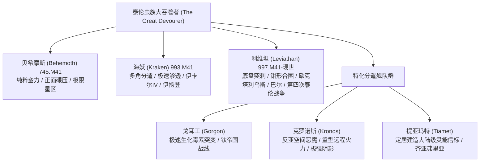

* **贝希摩斯（Hive Fleet Behemoth）**：
  * **时间与入侵路线**：745.M41。从银河系东南边缘突入极限星区（Ultima Segmentum），于泰兰主星（Tyran Primus）首次被审判官克里普特曼正式记录并由此定名“泰伦”，随后相继撕裂桑德罗斯星语站、贾加星及花园世界普兰迪姆，直扑极限战士母星马库拉格（Macragge）[Lexicanum] [官方: Codex: Tyranids (5th Edition)]。
  * **战术特点与决战马库拉格**：原始、蛮横的正面碾压战略（Overkill）。偏好投入巨量超重型怪兽（如大群刽子手 Carnifex）进行肉搏冲阵。决战马库拉格（Battle of Macragge）中，舰队直扑马库拉格轨道防御站、冰封的两极防御堡垒与冷钢山脊；在冷钢山脊面对马纽斯·卡尔加的精妙防御时，虫巢意志临时调集并首次实体化了具备古老统帅智能的群虫领主（The Swarmlord）重创卡尔加；极限战士第一连全员壮烈牺牲。最终帝国以牺牲帝国级战列舰“星辰之主号（Dominus Astra）”冲入母舰核心引爆亚空间跃迁引擎，形成局部亚空间引力坍缩与虚空黑洞，才彻底歼灭其母舰主力 [Lexicanum] [官方: Codex: Space Marines (5th Edition)]。
* **海妖（Hive Fleet Kraken）**：
  * **时间与入侵路线**：993.M41。吸取了贝希摩斯集群被歼灭的教训，海妖自东部边缘展开宽达上千光年的推进正面，分裂为无数支**分遣小舰队（Splinter Fleets）**实施多角包抄，主要攻势直指制造厂世界伊卡尔四号（Ichar IV）、帝皇之镰战团母星米拉尔（Miral Prime）与灵族方舟世界伊扬登（Iyanden）[Lexicanum] [官方: Codex: Tyranids (5th Edition)]。
  * **战术特点与伊扬登浩劫**：游击分割、多线开花与极速生物突变。重点投入高度敏捷的高阶近战撕裂生物。伊扬登浩劫中，数万亿近战虫群强行突破灵骨外壳涌入方舟内部走廊；尽管游侠王子伊瑞尔（Prince Yriel）率领海盗舰队回援并使用魔剑击杀母舰突触节点，伊扬登仍损失了五分之四的族人，迫使其战后极度依赖冥府死灵（Wraith constructs）维持防务。其裂片舰队具备极强自持与野火重生（Resilient Fragmentation）能力，残存生物舰散落至荒凉小行星带克隆母体快速分化出全新舰队，使帝国战后百年仍无法根除其毒害 [Lexicanum] [官方: Codex: Tyranids (8th Edition)]。
* **利维坦（Hive Fleet Leviathan）**：
  * **时间与入侵路线**：997.M41 首次爆发，持续至现世（战锤40K第十版）。其推进方向打破了此前边缘切入的惯例，直接从银河盘面**正下方（银河南极深空）垂直向上穿刺**，形成两只庞大的钳形卷须，同时包抄极限星区、太平星区与太阳星区腹地 [Lexicanum] [官方: Codex: Tyranids (8th Edition)]。
  * **战术特点与核心战事**：具备超高密度突触网络覆盖与全银河基因库大综合。在塔尔西斯二号极限战士第四连以生化毒素击退支脉；在欧克塔利乌斯大消耗战（Octarius War）中，克里普特曼引诱利维坦与兽人帝国百年生化绞杀，利维坦持续吞噬强韧兽人基因完成肉体强韧度的终极跃升；在巴尔之劫（The Devastation of Baal）集结上万艘生物舰围攻圣血天使母星，最终因大裂隙开启、恐虐大魔卡班哈干涉以及基里曼的不屈远征军抵达而遭重创；第四次泰伦战争（第十版主线）中在太平星区西部边境展现出有史以来最宏大的双头超级卷须——**诺蒂龙（Nautilon）**与**普罗米修尔（Promethor）**，随后第三支超级卷须**格伦迪鲁斯（Grendyllus）**破开巴斯蒂奥星区，兵锋直逼神圣泰拉，迫使帝国集结索尔之刃混编舰队筑垒死守 [Lexicanum] [官方: Warhammer 40,000 (10th Edition)]。
* **其他特化虫巢舰队**：
  * **戈耳工（Hive Fleet Gorgon）**：989.M41 侵入钛帝国，专注于快速微观生化毒素进化，能够在数小时内针对钛族等离子与脉冲科技合成免疫抗性与致命气溶胶 [Lexicanum]。
  * **克洛诺斯（Hive Fleet Kronos）**：伴随大裂隙诞生的反混沌特化舰队。鉴于混沌恶魔死亡后化为虚无、缺乏可回收有机质，克洛诺斯全面弃用近战以避免“生物质净亏损”，专门孵化射程超远的重型生化重炮（外分泌生化炮兽、生化炮兽、重炮武士群），并辐射高强度亚空间阴影以直接瓦解恶魔形体；虫巢意志甚至调动利维坦等友邻舰队，特意将部分已消灭抵抗但保留丰富有机质的星球“留给”克洛诺斯作为战役补给站，展现出跨舰队全局调配资源的宇宙级冷酷智能 [Lexicanum] [官方: Codex: Tyranids (8th Edition)]。
  * **提亚玛特（Hive Fleet Tiamet）**：极为罕见的定居型舰队，盘踞于齐亚弗里亚（Ziaphoria）星系。征服该星系后圈养土著生物为养分，驱使百亿兵虫在地表堆叠生长出高达数千公里的大陆级几丁质有机灵能天线（Organic Psychic Spire），长年环绕巡逻守护领地，疑似正向银河系外的虫族母体发送超远距离定位信标 [Lexicanum] [官方: Codex: Tyranids (8th Edition)]。

---

### 第2章 虫巢舰队全谱系战史与适应性剖析（舰队谱系）

虫巢舰队（Hive Fleet）并非单一僵化的星际军团，而是虫巢意志根据不同星区环境、主要猎物特征与战略困境定向演化出的巨型生态掠食实体。三大主宰舰队确立了帝国对泰伦战争的基本认知，而大量次级与裂片舰队则展现出极致的特化适应性 [Lexicanum] [官方: Codex: Tyranids (8th Edition)]。

#### 2.1 三大主宰虫巢舰队（三大泰伦战争主轴）

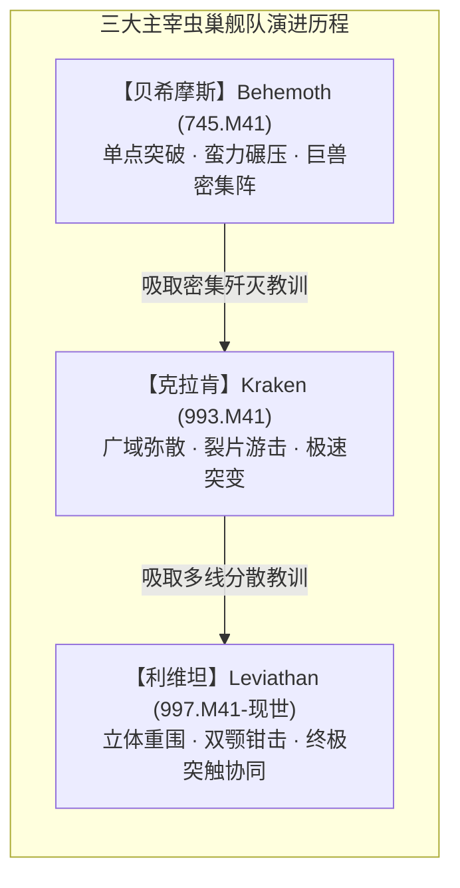

##### ① 贝希摩斯（Hive Fleet Behemoth）
* **进攻路线与关键战役**：
  * 首次接触与定名：745.M41，贝希摩斯自银河系东南边缘（极限星区东部边陲）突入。其首个被正式确认的受害世界为泰兰主星（Tyran Primus），审判官发掘的数据水晶确立了“泰伦”之名 [Lexicanum] [官方: Codex: Tyranids (5th Edition)]。
  * 推进路径：贝希摩斯以极为凝聚的单支超级矛头推进，相继撕裂桑德罗斯星语站（Thandros Telepathica）、贾加星（Jagga），以及五百世界中享有“极限星区粮仓”美誉的花园世界普兰迪姆（Prandium），将其彻底转化为死寂岩球 [Lexicanum]。
  * 决战马库拉格（Battle of Macragge）：舰队直扑极限战士战团母星马库拉格。战事在轨道防御站、冰封的两极防御堡垒（Polar Fortresses）与冷钢山脊（Cold Steel Ridge）爆发。轨道虚空战中，帝国海军拼死抵抗，但生物舰数量占据绝对压倒优势；最终帝国级战列舰“星辰之主号（Dominus Astra）”决死冲入母舰核心，超载其亚空间跃迁引擎引发灾难性引力坍缩，在虚空中形成吞噬性黑洞，方将贝希摩斯虚空主力同归于尽 [Lexicanum] [官方: Codex: Space Marines (5th Edition)]。
* **战术倾向**：
  * **单一聚焦正面突破（Spearhead Overkill）**：贝希摩斯几乎不进行佯攻或战略分散，全军以高度密集的阵列像生化攻城锤一般平推沿途阻碍 [Lexicanum]。
  * **超重型近战怪兽饱和投放**：偏好制造数量极其庞大的刽子手（Carnifex，帝国守军称之为“尖啸杀手 Screamer-Killer”），在地面战中依靠巨兽集群肉搏直接撞塌防御工事 [Lexicanum] [官方: Codex: Tyranids (3rd Edition)]。
* **已知适应性特征**：
  * **极限几丁质增厚**：贝希摩斯外骨骼呈现出深暗蓝与猩红结合的厚重甲壳，其几丁质层具有极强的抗动能穿透力 [Lexicanum]。
  * **首度演化出群虫领主（The Swarmlord）**：在冷钢山脊面对马库拉格守军指挥官马纽斯·卡尔加（Marneus Calgar）的精妙防御时，虫巢意志临时调集并首次实体化了具备古老统帅智能的群虫领主，以超越阿斯塔特的近战与战术谋略斩断卡尔加四肢、重创极限战士指挥中枢 [Lexicanum] [官方: Codex: Tyranids (5th Edition)]。
  * **传奇个体“独眼狂怒”（Old One Eye）**：马库拉格战役中诞生的暴君刽子手变体，头部遭受等离子手枪近距离直击贯穿眼眶仍未死亡，具备极罕见的超速细胞再生能力，战后冰封于寒冰中，随后数百年内数度苏醒屠戮帝国部队 [Lexicanum]。

##### ② 克拉肯（Hive Fleet Kraken）
* **进攻路线与关键战役**：
  * 爆发时间：993.M41，在贝希摩斯溃败近250年后，第二场全银河级泰伦危机爆发于东部边缘 [Lexicanum] [官方: Codex: Tyranids (5th Edition)]。
  * 推进路径与分散模式：克拉肯彻底摒弃了贝希摩斯的密集聚团路线，在数千光年的宽大正面同时推进。主要战区包括：帝国重工业制造厂世界伊卡尔四号（Ichar IV）、阿斯塔特帝皇之镰战团母星米拉尔（Miral Prime，爆发“巨人之棺”惨烈撤退战），以及灵族方舟世界伊扬登（Iyanden）[Lexicanum] [官方: Codex: Craftworlds (8th Edition)]。
  * 伊扬登浩劫：克拉肯的生物舰队将这艘庞大的艾达灵族方舟世界团团围困。数万亿近战虫群强行突破灵骨外壳涌入方舟内部走廊。尽管游侠王子伊瑞尔（Prince Yriel）率领海盗舰队回援并使用魔剑击杀母舰突触节点，伊扬登仍损失了五分之四的族人，导致其文明遭受永久性创伤，不得不大规模唤醒死灵构造体（Wraith constructs）弥补人口空缺 [Lexicanum]。
* **战术倾向**：
  * **多角分遣包抄（Splinter Swarms）**：克拉肯将主力拆解为成百上千支中小型“裂片舰队”，从多个不同矢量同时袭击邻近星系，使帝国海军疲于奔命、无法集中主力决战 [Lexicanum]。
  * **极速渗透与先锋协同**：与潜伏已久的基因窃取者教派（如伊卡尔四号上的“四臂神皇教派”）形成严密时空同步，舰队抵挡前夜星球内部爆发大暴动摧毁防空系统 [Lexicanum] [官方: Codex: Genestealer Cults]。
* **已知适应性特征**：
  * **极高神经敏捷度与高机动撕裂体**：克拉肯孵化的近战跳跃生物（霍玛冈特、剑圣武士）比例畸高，其肌肉传导效率与冲锋爆发力显著超越贝希摩斯 [Lexicanum]。
  * **裂片自持与野火重生（Resilient Fragmentation）**：当一支裂片舰队被重创后，残存生物舰并不会溃逃，而是就近散落至荒凉小行星带或未开化殖民地，利用微量有机质迅速克隆母体，在数月内分化出全新小舰队，导致帝国在战后数十乃至上百年内仍无法根除克拉肯余毒 [Lexicanum] [官方: Codex: Tyranids (8th Edition)]。

##### ③ 利维坦（Hive Fleet Leviathan）
* **进攻路线与关键战役**：
  * 爆发时间：997.M41 首度被记录，并持续延展至战锤40K现世第十版时代 [Lexicanum] [官方: Warhammer 40,000 (10th Edition)]。
  * 突破维度的进攻航线：利维坦颠覆了过往虫巢舰队从银河系外围边缘横向切入的规律，其主力自银河盘面**正下方（银河南极深空）垂直向上穿刺**，如同一头巨兽自深渊浮出水面，直接将攻击锋芒探入银河系腹地 [Lexicanum] [官方: Codex: Tyranids (8th Edition)]。
  * 战略战区与转折点：
    * 塔尔西斯二号（Tarsis Ultra）：极限战士第四连连长乌列尔·文特里斯（Uriel Ventris）联手机械教研发生化毒素直刺诺恩虫后，艰难击退一条支脉 [Lexicanum] [官方: Warriors of Ultramar (Novel)]。
    * 欧克塔利乌斯大消耗战（Octarius War）：审判官克里普特曼为推迟利维坦逼近泰拉，利用基因诱饵将利维坦主卷须引向欧克兽人帝国欧克塔利乌斯。这场百年血战导致数万亿兽人与泰伦陷入无限生化绞杀，但利维坦非但未被耗死，反而通过持续吞噬兽人超密度骨骼与真菌生理结构完成了肉体强韧度的终极跃升 [Lexicanum] [官方: War Zone Octarius]。
    * 巴尔之劫（The Devastation of Baal）：利维坦集结上万艘生物舰包围圣血天使母星巴尔与双子卫星，摧毁了数十个阿斯塔特子团防线。战役末期大裂隙撕裂现实，恐虐恶魔军团降临屠戮虫群，随后罗伯特·基里曼率不屈远征主力军抵达，利维坦巴尔卷须遭遇重创 [Lexicanum] [官方: The Devastation of Baal]。
    * 第四次泰伦战争（Fourth Tyrannic War，第十版主线）：利维坦并未消退，反而在太平星区西部边境展现出有史以来最宏大的双头超级卷须——**诺蒂龙（Nautilon）**与**普罗米修尔（Promethor）**，随后第三支超级卷须**格伦迪鲁斯（Grendyllus）**破开巴斯蒂奥星区（Bastior Sub-sector）。帝国最高领主与基里曼不得不调配“索尔之刃（Solblades）”特遣混编舰队全力构建封锁线以保卫神圣泰拉 [Lexicanum] [官方: Warhammer 40,000 (10th Edition)]。
* **战术倾向**：
  * **立体钳形包夹（Dual-tendril Pincer）**：利维坦擅长动用数万光年尺度的宏观战略协同，一支卷须负责吸引并消耗星区帝国主力，另一支卷须在侧翼或腹背实施无情收割 [Lexicanum]。
  * **超高密度突触网络覆盖**：其战场几乎没有任何单点指挥中枢的脆弱弱点，突触节点重叠交织，低等生物几乎永不陷入本能溃乱 [Lexicanum]。
* **已知适应性特征**：
  * **基因库全面大综合**：融合了全银河所有主要文明与生物的优良基因，诞生了新一代特化指挥与刺杀节点——如**神经暴君（Neurotyrant）**与**诺恩使者（Norn Emissary）** [Lexicanum] [官方: Warhammer 40,000 (10th Edition)]。
  * **极高毒素与辐射耐受性**：吸收欧克兽人基因后，利维坦的细胞壁能抵抗常规生化武器与微波辐射，其外甲普遍呈现出惨白的骨色几丁质与深紫色甲壳结合 [Lexicanum]。

---

#### 2.2 次级与特化裂片舰队独立图鉴

除了三大主力舰队，虫巢意志在不同战区与特殊敌人交锋时，分化并部署了多支高度极端化的次级舰队 [Lexicanum] [官方: Codex: Tyranids (8th Edition)]：

##### ① 九头蛇（Hive Fleet Hydra）
* **演化背景与特征**：九头蛇舰队是一支具有**自噬同类（Cannibalistic / Necrophagic）**特性的舰队 [Lexicanum]。
* **战术机制**：九头蛇并不开拓全新的入侵走廊，而是紧随其他被打散、重创的虫巢舰队残迹行动。当遭遇已经死亡或奄奄一息的泰伦生物尸堆与残破生物舰时，九头蛇会毫不犹豫地将其全数吞入消化池，瞬间吸收其积累的全部环境抵抗力与抗性代码 [Lexicanum] [官方: Codex: Tyranids (8th Edition)]。
* **战场表现**：九头蛇拥有银河系最惊人的兵员补充与再生速率。在地面战中，九头蛇投入无边无际的微型泰伦群（Hormagaunts / Termagants），其数量甚至多到将己方前锋踩踏碾碎，以无穷无尽的肉体消耗战压垮任何严密的防守阵地 [Lexicanum]。

##### ② 约尔蒙甘德（Hive Fleet Jormungandr）
* **演化背景与特征**：995.M41 于塔拉西亚星区被帝国海军上将汉洛斯（Admiral Vortigern Hanroth）拦截并命名。约尔蒙甘德在虚空中呈现出独特的如同巨蛇蟠曲般的长条形游弋阵列 [Lexicanum] [官方: Codex: Tyranids (5th Edition)]。
* **战术机制（地下坑道潜伏突袭）**：
  * 约尔蒙甘德极少使用常规的高调轨道空投囊（Mycetic Spores）。在虚空中，生物舰会捕获小行星与太空气体巨石，在其中掏空并填塞进海量的掘地巨兽（Trygon、Ravener、Mawloc）[Lexicanum]。
  * 这些陨石被当作无动力被动弹药射向目标星球，避开行星轨道防御网的虚空扫描。一旦陨石撞击地表，潜伏在地核浅层的掘地生物立刻疯狂挖掘，在整座要塞或巢都的地基下开凿出纵横交错的地下坑道网，随后由内向外彻底瓦解守军的地面工事 [Lexicanum] [官方: Codex: Tyranids (8th Edition)]。

##### ③ 提亚玛特（Hive Fleet Tiamet）
* **演化背景与特征**：提亚玛特是目前已知银河系中**唯一一支定居型（Sedentary / Territorial）虫巢舰队**，盘踞于齐亚弗里亚（Ziaphoria）星系 [Lexicanum] [官方: Codex: Tyranids (8th Edition)]。
* **战术机制（守护超级灵能信标）**：
  * 提亚玛特在征服齐亚弗里亚诸世界后，一反常态地没有将行星吞噬至基岩，而是圈养了部分土著生物作为生物养分源，驱使数以百亿计的兵虫在地表堆叠生长出一座高达数千公里的**大陆级几丁质有机灵能天线（Organic Psychic Spire）** [Lexicanum]。
  * 整个舰队长年环绕该星系巡逻，展现出极强的领地守护意识与防御姿态。帝国死亡守望（Deathwatch）与灵族先知均指出，该信标所散发的心灵共鸣正在跨越银河虚空，极可能正在召唤潜伏在河外深空的泰伦真正超级本体 [Lexicanum]。其生物外壳呈现坚硬如金刚石的极高密度甲壳结构 [Fandom]。

##### ④ 戈耳工（Hive Fleet Gorgon）
* **演化背景与特征**：989-990.M41 侵入钛帝国凯尔珊星区（Kel'shan）。戈耳工的舰队物理体量相对有限，无法承受如同贝希摩斯般的漫长消耗战 [Lexicanum] [官方: Codex: Tyranids (4th Edition)]。
* **战术机制（极速分子毒素突变）**：
  * 戈耳工是泰伦在微观生物化学层面的最高杰作。面对钛帝国高科技脉冲武器与克鲁特辅助军，戈耳工展现出了以“小时”甚至“分钟”为单位的即时免疫与毒素研发机制 [Lexicanum]。
  * 当一批霍玛冈特被钛星人脉冲步枪消灭后，下一波孵化的虫群便会分泌出能吸收该波段热能的耐火体液；若敌方更换为等离子武器，虫群会在几代繁殖内合成出完全针对钛族呼吸道黏膜的致命强酸神经气溶胶，强行渗透动力装甲密闭过滤网。戈耳工催生了极高比例的剧毒囊兽（Toxicrene）与毒气虫（Venomthrope）[Lexicanum] [官方: Codex: Tyranids (6th Edition)]。

##### ⑤ 那迦（Hive Fleet Naga）
* **演化背景与特征**：801-812.M41 活跃于银河系边缘的早期裂片舰队，肆虐了大量灵族拓荒世界（Exodite Worlds）并对伊扬登方舟与玛兰泰（Malan'tai）构成了极大威胁 [Lexicanum] [官方: Codex: Tyranids (5th Edition)]。
* **战术机制（制空权压制与外分泌酸液）**：
  * 那迦舰队特化于极高比例的空战飞行生物体系（如石 interface 翼手龙、哈耳庇厄 Harpy 与极度庞大的飞天虫群），在轨道轰炸阶段便彻底剥夺猎物星球的制空权 [Lexicanum]。
  * 玛兰泰的覆灭（Doom of Malan'tai）正是那迦舰队遗留特化突触生物所引发的惨剧：一头特殊的佐安索普变体潜入方舟无限回路，吸干了千万艾达死者灵魂，其灵能膨胀至能够单体爆裂整座战舰 [Lexicanum] [官方: Codex: Tyranids (5th Edition)]。

##### ⑥ 欧罗波罗斯（Hive Fleet Ouroboros）
* **演化背景与特征**：被帝国记录的最古老虫巢舰队之一，最早可追溯至第36千年（M36）的赫利坎圣战（Helican Crusade）记录中，被帝国学者推测为泰伦在史前纪元向银河系发射的远古先锋试验波次 [Lexicanum] [官方: Codex: Tyranids (8th Edition)]。
* **战术机制（原始飞翼狂潮与野性咆哮）**：
  * 欧罗波罗斯体内的基因序列保留了大量“原始/史前”特征。其生物体体表覆盖着粗糙、带有瘤结与骨刺的远古几丁质板，外观多呈深黑斑驳带有墨绿纹路 [Lexicanum]。
  * 该舰队高度偏好翼膜生物，铺天盖地的飞翼猛兽遮蔽阳光；更为恐怖的是，其伴生的亚空间阴影并非冰冷的寂静或蜂鸣，而是一种极其原始的**野兽饥渴咆哮（Bestial Cacophony）**，极易使直面它的灵能者直接退化为失去理智的疯狂野兽 [Lexicanum] [官方: Codex: Tyranids (8th Edition)]。

##### ⑦ 克洛诺斯（Hive Fleet Kronos）
* **演化背景与特征**：诞生于第41千年末期大裂隙（Cicatrix Maledictum）撕裂银河之际，专门针对混沌恶魔与亚空间异象而演化的“猎魔特化舰队” [Lexicanum] [官方: Codex: Tyranids (8th Edition)]。
* **战术机制（纯远程生化轰炸与零肉搏）**：
  * 混沌恶魔在被击杀后会直接化作亚空间虚无瓦解，无法为虫巢意志提供任何可供摄取的蛋白质或无机质；在恶魔横行的战场进行近战肉搏对泰伦而言是纯粹的“生物质净亏损” [Lexicanum]。
  * 因此，克洛诺斯几乎完全摒弃了传统的近战冲锋兵种，全军由高阶远程火力单位构成：外分泌生化炮兽（Exocrine）、生化炮兽（Biovore）、装备重型毒液加农炮与死亡绞杀炮的泰伦武士群。克洛诺斯在超视距对恶魔实施狂轰滥炸，以最小的物理接触消灭混沌实体 [Lexicanum] [官方: Codex: Tyranids (8th Edition)]。
* **后勤补给网（舰队间战略协同）**：
  * 鉴于克洛诺斯自身无法从恶魔身上获得充足补给，虫巢意志调动了利维坦等友邻舰队，特意将部分已经被彻底打散但保留了丰富有机质的帝国星球“留给”克洛诺斯作为战役补给站，展现出虫巢意志跨舰队全局调配资源的宇宙级冷酷智能 [Lexicanum]。

---

#### 2.3 舰队间核心差异对照

不同虫巢舰队之间不仅在外观配色与兵种配比上存在显著区别，其核心突触网络拓扑与灵能对抗机理亦呈现明显的代际分歧：

| 虫巢舰队 | 突触网络拓扑架构与密度 | 对灵能/亚空间实体的针对性演化机理 | 战术核心信条 | 文献标注文献 |
| :--- | :--- | :--- | :--- | :--- |
| **贝希摩斯** *(Behemoth)* | 单核高度集中型：极度依赖少数巨兽节点（虫巢暴君、母舰主脑），一旦斩首易产生局部退化。 | 基础亚空间杂音：依靠纯物理压倒性数量形成粗暴的亚空间阻滞，缺乏精细反制。 | 正面重锤突破，超重装甲冲击。 | [Lexicanum] [官方: Codex (5th)] |
| **克拉肯** *(Kraken)* | 弥散网状自愈型：裂片舰队各配独立微型突触包，节点扁平化，自主决策权高。 | 敏捷规避型：以快速游走削弱灵能侦测精度，利用高速近战兵种压迫灵能施法窗口。 | 分割包抄，极速多点穿插。 | [Lexicanum] [官方: Codex (8th)] |
| **利维坦** *(Leviathan)* | 超级多重冗余矩阵：拥有指挥中继网（如神经暴君），具备微秒级跨层级接管能力。 | 神经窒息狂潮：亚空间阴影广度达到星区级，能大面积致盲领航员并诱发凡人自残。 | 大规模钳形合围，全维度资源绞杀。 | [Lexicanum] [官方: 10th Core] |
| **九头蛇** *(Hydra)* | 动态吸收重构型：突触节点具备死者记忆继承特性，通过自噬快速修复网络缺失。 | 杂波震荡干扰：散发迷乱的集群回波，使敌方灵能侦测无法锁定真正的主脑位置。 | 尸潮吞噬，无休止肉体饱和轰炸。 | [Lexicanum] [官方: Codex (8th)] |
| **提亚玛特** *(Tiamet)* | 锚定巨型阵列型：全舰队突触频率与齐亚弗里亚地表大陆天线同频共振，稳定性极强。 | 超远程信标共鸣：灵能矩阵具备极强的定向发射性，几丁质外骨骼能折射敌方灵能长矛。 | 固守核心星系，建造巨构灵能信标。 | [Lexicanum] [官方: Codex (8th)] |
| **克洛诺斯** *(Kronos)* | 猎魔共鸣力场型：突触生物充当“抑灵阵列”，高阶突触单位专职亚空间实体放电。 | **高度强化的亚空间阴影（The Shadow Heightened）**：共鸣频率直接切断恶魔与亚空间联系，导致亚空间裂隙坍缩与恶魔形体溶解。 | 极致远程生化火力压制，避免近战亏损。 | [Lexicanum] [官方: Codex (8th)] |

---

---

### 第3章 虚空生物舰解剖学与生态位分类（生物舰图鉴）

泰伦虫族的虚空舰队在帝国海军（Imperial Navy）战术代号体系中被划分为由大到小的活体星舰级别。生物舰不依赖金属冷轧与核动力炉，其整体由特化的多层角质骨板、脉动血管、神经索与肌肉液压纤维组织构成 [Lexicanum] [官方: Battlefleet Gothic Resources]。

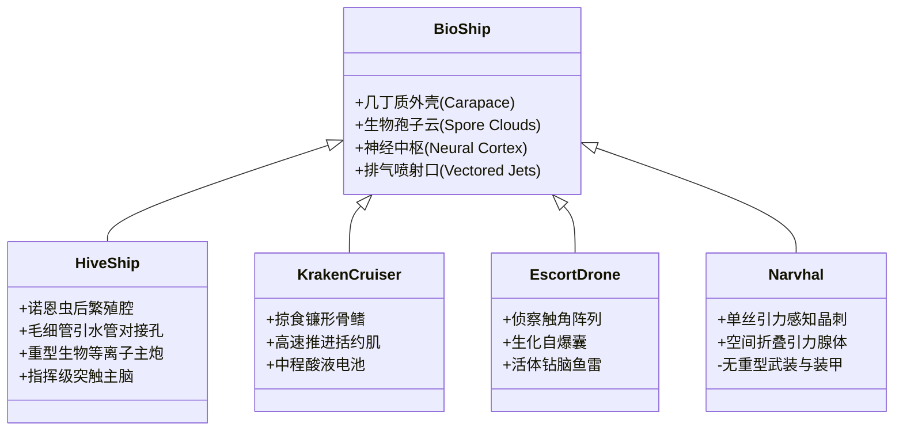

#### 3.1 虫巢舰（母舰 / Hive Ship）
* **战舰评级与生理尺度**：
  * 相当于帝国海军战列舰（Battleship）至大巡洋舰级，舰长通常在 5 至 10 公里以上，部分古老的始祖级巨舰可达数十公里，体量媲美小型卫星 [Lexicanum] [官方: Battlefleet Gothic Armada]。
* **解剖构造与内部机理**：
  * **诺恩虫后生化圣殿（Sanctum of the Norn-Queen）**：位于全舰重装甲层最深处，被厚达数百米的致密几丁质与液压脂肪囊包覆。诺恩虫后居于中央羊水池中，负责整个舰队的基因突变设计、孵化受精与战略推演 [Lexicanum]。
  * **循环与管道网络**：体内具有多颗巨大的副心脏与直径达数十米的搏动主动脉，其内部流淌着富含氧与高能养分的绿色血淋巴。巨大的内脏空腔兼具孕育池（Gestation Pools）与有机质消化仓库功能 [Lexicanum] [官方: Battlefleet Gothic Magazine]。
  * **主脑级突触中枢（Primary Synaptic Core）**：头部长有庞大的外露脑回半球，由数层半透明的灵能角质膜保护，是全舰队千万突触生物的意志汇聚点与命令源头 [Lexicanum]。
* **战斗生态位**：
  * 作为虫巢舰队的核心旗舰与移动兵工厂。在太空战中，母舰坐镇中枢，利用庞大的生物等离子巨炮与生化鱼雷群进行跨轨道远程压制；在行星同化阶段，母舰降轨悬停，垂下数公里长的吻管与地表毛细管塔咬合完成行星吞噬 [Lexicanum]。

#### 3.2 克拉肯级巡洋舰（Kraken-class Cruiser / 巡洋舰系）
* **战舰评级与生理尺度**：
  * 相当于帝国巡洋舰（Cruiser）级别，舰长约 1.5 至 3 公里，在哥特舰队规则中常对应为吞噬者级（Devourer）、虚空潜伏者级（Void Prowler）等不同武器配置亚型 [Lexicanum] [官方: Battlefleet Gothic Armada]。
* **解剖构造与流线设计**：
  * 外形极度流线化，形似身覆重壳的星际头足纲或掠食性远古古鱼类。舰身两侧长有巨大的镰刀状几丁质稳定鳍，尾部配有由数组强力环状肌肉括约肌构成的生物喷流引擎，依靠喷射高压气体与化学反冲获得极高的太空机动性 [Lexicanum]。
* **战斗生态位**：
  * 舰队的主力中坚力量。克拉肯级巡洋舰以狼群战术集群行动，游弋在母舰两翼，利用高航速切入敌方战列线侧翼，使用高温酸液炮齐射削弱敌舰虚空盾，随后贴近撕咬敌军巡洋舰并施放登舰触手 [Lexicanum] [Fandom]。

#### 3.3 护卫与先锋无人舰（Escorts & Vanguard Drone Ships）
* **战舰评级与生理尺度**：
  * 舰长 200 米至 800 米之间，数量不可胜数，充当帝国护卫舰与驱逐舰的生态对标物 [Lexicanum]。
* **主要特化亚型**：
  1. **先锋侦察无人舰（Vanguard Drone）**：装配超长的单丝化学感知须，外壳具备变色与吸波吸热特性，潜伏于星系外围，专门捕捉猎物文明的电磁通讯与舰船尾迹 [Lexicanum]。
  2. **绞杀者无人舰（Strangler Drone）**：舰艏特化为大型绞杀藤囊，向敌方护卫舰发射急速生长的倒钩菌丝，缠绕并瘫痪敌方炮塔与姿态控制喷口 [官方: Battlefleet Gothic Resources]。
  3. **潜伏者无人舰（Stalker Drone）**：高度特化近身肉搏与高速撞击，搭载大量纯血基因窃取者空投囊，以自杀式贴靠强行刺入敌舰装甲外壳 [Lexicanum]。
* **战斗生态位**：
  * 作为肉盾与先导防空网。无人舰仅具备微弱的动物自保本能，由母舰突触统一遥控，在决战时组成连绵数万公里的致密肉墙，主动以肉身抵挡帝国光矛（Lance）与宏炮弹药，为母舰争取接近时间 [Lexicanum]。

#### 3.4 剃刀蜂群舰（Razorfiend）
* **解剖构造与武器外骨骼**：
  * 隶属于帝国海军分类中高危险性的重型近战突击生物舰（Assault Cruiser Variant）[官方: Battlefleet Gothic Magazine]。
  * 其舰艏并非软体组织，而是向前延展出数根长达百米、由超高密度金刚石硬度几丁质融合而成的尖锐撞角（Ramming Spur），舰脊与腹部长满了极其锋利的剃刀状骨刃背鳍 [Lexicanum] [官方: Battlefleet Gothic Resources]。
* **战斗生态位（虚空破舰攻城锤）**：
  * 剃刀蜂群舰是纯粹为“虚空撞角战术与跳帮突击”而生的恐怖物种。它在尾部大推力脉冲气腔的驱动下获得恐怖的瞬时加速度，在虚空中直接撞穿帝国巡洋舰的重型装甲侧舷；撞击深入后，其撞角结构内部会裂开为排泄口，向敌舰舱室疯狂倾泻数以万计的霍玛冈特与酸液虫群，在数十分钟内将受害舰船内人员啃食殆尽 [Lexicanum]。

#### 3.5 腐蚀舰（Caustic / Corrosive Vessels）
* **解剖构造与腺体特化**：
  * 涵盖巡洋舰级与重型护卫级，其内部内脏布局与常规舰船显著不同：消化道与肌肉组织被严重压缩，体内近65%的容积被数个极度膨胀的发泡生化毒囊（Vitriolic Bladders）占据 [官方: Battlefleet Gothic Magazine] [Fandom]。
* **战斗生态位（虚空盾破除与分子消解）**：
  * 腐蚀舰的主要使命是瓦解敌方重装战列舰与虚空空间站的厚重外壳。其舰艏喷射孔能将数千吨超浓缩生化强酸、热解胆汁与高活性消化酶以高速射流的形式射向目标 [Lexicanum]。
  * 这些腐蚀剂不仅能在瞬间中和并过载帝国的虚空盾力场，其高附着性液体在真空中依然剧烈沸腾腐蚀，能在数秒内将十数米厚的精金与陶瓷复合装甲板融化为发泡的金属残渣，为后续母舰的捕食触须开辟入口 [Lexicanum]。

#### 3.6 独角鲸舰（Narvhal）深空引力航行机理与序列解析

独角鲸舰是泰伦跨越无尽深空的关键枢纽，其存在彻底填补了泰伦虫族在不涉足亚空间航行（Warp Travel）前提下实现星际跨越的理论拼图 [Lexicanum] [官方: Codex: Tyranids (5th Edition)]：

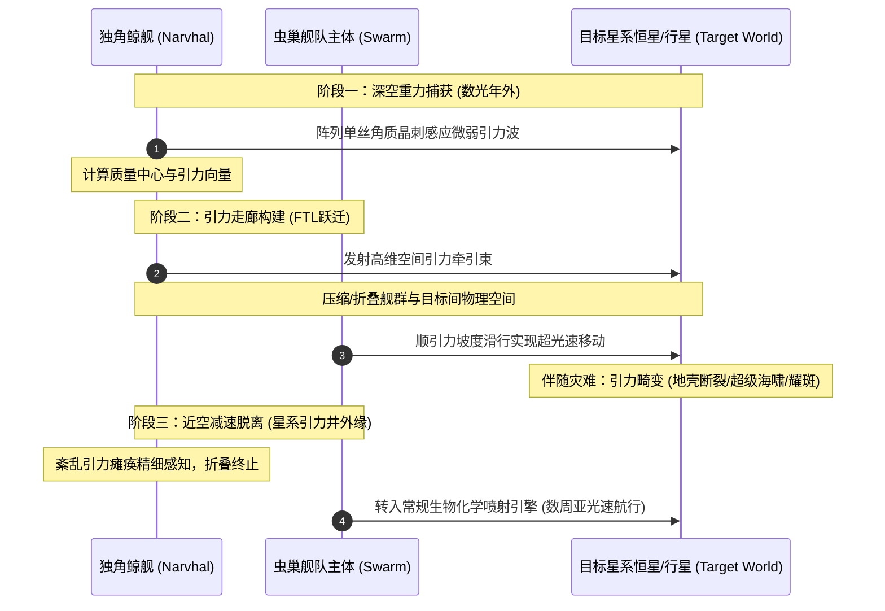

* **生态位与生理防护**：
  * 独角鲸舰是一类体型娇小（通常仅数百米长）、行动极其迟缓的特化功能舰。它全身几乎没有任何重型防御角质板与进攻性器官，极度脆弱，因此在航行与战斗中长年被深藏在庞大虫巢舰队的最核心腹地，由数艘母舰与无数护卫蜂群层层包裹保护 [Lexicanum]。
* **引力感应与空间折叠机理**：
  * **单丝晶刺阵列（Monofilament Sensory Spines）**：独角鲸舰前部延伸出如树冠般庞大的晶质硬质触角，其内部蕴含高度敏感的压电神经元，能在数光年甚至数十光年外精确捕捉目标恒星系核心恒星与大质量气态巨行星所散发出的极其微弱的引力波颤动 [Lexicanum]。
  * **引力走廊制造（Gravimetric Conduit）**：在锁定引力源后，独角鲸舰利用其体内特化的重力操控生化腺体，向目标投射出一道高维空间引力扰动束，强行“拉拽”并压缩目标天体与舰队之间的空间连续体。虫巢舰队整体顺着这条人造的极端重力倾斜坡度“顺流滑下”，从而在现实宇宙中达成超越光速的星际位移，完美规避了亚空间风暴与恶魔对舰队的侵蚀 [Lexicanum] [官方: Codex: Tyranids (5th Edition)]。
* **物理局限与近星系亚光速过渡**：
  * 引力走廊航行存在不可逾越的物理限制：当舰队逼近目标星系的“强引力井”（如柯伊伯带或外缘行星轨道）时，来自多颗行星与主恒星的交叉混乱重力场会彻底瘫痪独角鲸舰单丝晶刺的精细感应。
  * 此时，引力走廊必须强制解离，舰队立刻脱离超光速状态，转为依赖生物喷气孔（冷气体喷射与高压排泄括约肌）进行常规亚光速滑行。这一减速与最终贴近阶段通常需耗费数个标准周至数月，也是帝国行星守军在轨道防御战中唯一能够组织舰队打乱其阵型的宝贵战术窗口 [Lexicanum]。
* **天体级伴生灾害（无意识生态软化）**：
  * 独角鲸舰拉扯引力的过程会跨光年向目标星系投送巨大的重力潮汐力。在舰队主体尚未现身前数年或数月，目标行星便会自发陷入反常的地轴震颤、特大海啸、大陆板块错位撕裂以及主恒星剧烈电磁耀斑喷发，无形中在舰队抵达前彻底摧毁了守军的民生地表建筑、防空电网与轨道通信基站 [Lexicanum]。

---

---

### 第4章 虚空生物舰重型武器与生化阵列

在战锤40K的虚空战舰序列中，泰伦生物舰的武器系统完全不依赖机械装填、电磁线圈或激光晶体，全数由共生于星舰体内的特化活体武器器官（Weapon Symbiotes）与高压腺体组成 [Lexicanum] [官方: Battlefleet Gothic Resources]：

#### 4.1 捕食触须与登舰器官（Feeder & Boarding Tentacles）
* **解剖形态与锚定机制**：
  * 长于虫巢舰与突击巡洋舰下颌及舰艏的庞大肌肉组织，展开时长度可达数百米乃至数公里。触须表面密布着由硬化几丁质打造的倒钩、环形锯齿吸盘以及不断渗出强力黏性蛋白质的黏膜孔 [Lexicanum]。
* **实战效能**：
  * **物理捕获与装甲撕扯**：当生物舰贴近帝国星舰时，数条捕食触须如同巨蟒般缠绕敌舰舰体，硬化倒钩深深楔入敌舰装甲板缝隙，强行将目标拖向母舰下方的活体口器 [官方: Battlefleet Gothic Armada]。
  * **活体登船走廊（Organic Boarding Umbilical）**：触须不仅能挤压撕裂金属装甲，其中空的肌腱管道能分泌高浓度强酸在敌舰外壳熔出大洞，随后将高压缩状态的基因窃取者（Genestealers）、霍玛冈特以及吞噬虫卵直接“注入”敌舰走廊与机舱，从内部屠戮舰员并瘫痪引擎 [Lexicanum]。

#### 4.2 高温热解酸与强酸喷射阵列（Pyro-acid Batteries & Vitriolic Sprays）
* **生化反应与发射机理**：
  * **高温热解酸炮（Pyro-acid Batteries）**：位于生物舰侧舷的大型肉质喷射孔。体内两组隔离的腺体分别合成高挥发性有机酸与过氧化生物助燃酶，在强力肌肉痉挛挤压下在喷射管内混合，以数倍超音速的初速向真空射出炽热发光的酸液球 [Lexicanum] [官方: Battlefleet Gothic Armada]。
* **终端毁伤效应**：
  * 热解酸在撞击敌舰装甲后爆发出数千度高温并伴随极强分子级腐蚀。该液体具有遇氧与遇铁自燃特性，不仅能击穿十数层装甲钢板，更能在渗透入舱段后引发全船不可熄灭的生化炼狱大火，即使在损管队抽干舱内氧气后，其自带的氧化酶依然能维持数小时的剧烈阴燃 [Lexicanum]。

#### 4.3 虚空孢子排放系统与活体孢子地雷（Spore Chimneys & Void Mines）
* **排放器官构造**：
  * 贯穿生物舰背部与侧甲的整齐气孔列阵，被称为**虚空孢子烟囱（Dorsal Spore Chimneys）**。由深层肺泡与生物加压腔室控制开关 [Lexicanum]。
* **双重战术功能**：
  1. **虚空孢子云雾防御（Spore Clouds Countermeasure）**：生物舰在航行与交战时日夜不停地向真空喷薄海量的微观孢子、几丁质碎屑与纤维角蛋白粉尘。这层浓厚的活体迷雾如同一面活动的偏折护盾，能有效折射、散射帝国海军的光矛激光射线，并使宏炮实心穿甲弹丸在穿过孢子云时提前受到巨大阻力发生引爆与偏转，大幅降低常规火力的命中精准度 [Lexicanum] [官方: Battlefleet Gothic Resources]。
  2. **活体虚空孢子地雷（Void Spore Mines）**：通过大型括约肌发射筒排入太空的活体炸弹。每个孢子地雷外覆防寒胶质膜，内部装有对热源与引擎离子羽流极度敏感的单细胞受体，尾部生有喷气纤毛。当敌舰靠近时，孢子地雷会成群结队如游鱼般追踪敌舰，撞击后引爆内部的强酸囊或生化等离子气囊 [Lexicanum]。

#### 4.4 生物等离子释放器（Bio-plasma Discharges）
* **能量转化机理**：
  * 生物舰所搭载的最具毁灭性的重型能量武装。舰体内装配专门的电气化组织与共生电离腺体，通过对消化过程中提取的高能碳氢化合物进行剧烈的高压电离代谢，在能量腔体内汇聚出极端炽热的过热等离子球体 [Lexicanum] [官方: Codex: Tyranids (5th Edition)]。
* **战术毁灭表现**：
  * 位于母舰舰艏与脊椎主发射腔的生物等离子巨炮，在发射时呈现出耀眼的惨绿或幽蓝烈焰。其射流威力与温度完全不亚于机械教重型等离子加速炮（Plasma Accelerators）。一发完全蓄力的生物等离子吐息能够在一瞬间撕碎帝国主力舰的层层虚空盾，将下方数千吨的精金龙骨与装甲甲板直接气化蒸发为炽热的熔融等离子气体 [Lexicanum] [官方: Battlefleet Gothic Armada]。

#### 4.5 辅助与异型虚空武装
* **生化鱼雷与穿甲钻脑虫囊（Boarding Torpedoes & Fleshborer Hives）**：
  * 搭载硬质锥形破甲骨锥的巨型活体鱼雷，具备独立的神经导航脑，能在真空航行中微调弹道躲避近防激光拦截，穿透舰壳后散布钻脑虫 [Lexicanum]。
* **几丁质撕裂冲角与吸积骨刺（Hardened Prows & Chitinous Blades）**：
  * 纯物理动能结构，利用生物无机矿化作用（Biomineralization）将大量从被吞噬世界开采的重金属与硅酸盐熔铸于星舰前部，形成天然破甲冲击刃 [Lexicanum]。

---

---

### 第5章 战役实录对比：帝国战术教条演变

帝国海军在与泰伦生物舰队的长期交锋中，总结并经历了三次战术教条的血腥迭代 [官方: Battlefleet Gothic Armada] [Lexicanum]：

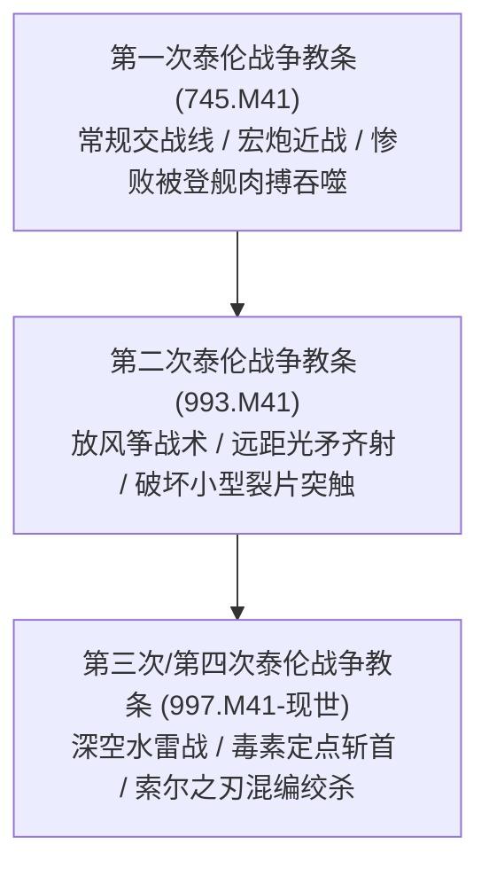

1. **早期盲动与溃败（第一次泰伦战争）**：
   * 帝国海军初期将生物舰误判为无防护的“太空漂浮怪兽”，试图以传统的近距线列阵宏炮齐射解决问题。然而，近距交战正中泰伦下怀，帝国舰船遭到海量孢子云迷盲、被捕食触须锁死并面临数万头跳帮异形的内部洗劫，导致第十二战区近半数主力战列舰在马库拉格惨遭血洗 [Lexicanum]。
2. **“放风筝”远距离截击战术（第二次泰伦战争）**：
   * 上将 Hanroth 与极限战士舰队开始强调速度与交战距离。帝国舰队保持在生物等离子与酸液最大射程之外，利用远程舰载光矛（Lances）与鱼雷齐射，首先点杀外围防御较弱的克拉肯级与先锋无人舰，逐层剥离其突触掩护，严禁任何战舰陷入肉搏死角 [Lexicanum] [官方: Battlefleet Gothic Armada]。
3. **特化毒素与引力诱导（第三/第四次泰伦战争）**：
   * 机械教开始逆向研发生物毒素，如塔尔西斯二号战役中使用的针对性神经衰竭毒素；同时，审判庭利用捕获的基因窃取者释放虚假信息素，人为诱导独角鲸舰引力航行发生重力偏移，将虫巢舰队引入超新星遗迹、黑洞边缘或无机质的死星系实施歼灭 [Lexicanum] [官方: Codex: Tyranids (8th Edition)]。

---

---

### 第6章 虚空核心术语与舰船代号对照表（Glossary）

| 序号 | 帝国海军代号 / 中文术语 | 官方英文名称 | 战术/生态位职能定位 | 来源标注文献 |
| :---: | :--- | :--- | :--- | :--- |
| 1 | **虫巢舰** | Hive Ship | 战列舰级母舰，诺恩虫后居所与舰队突触指挥中枢。 | [Lexicanum] [官方: BFG] |
| 2 | **克拉肯级巡洋舰** | Kraken-class Cruiser | 巡洋舰级主力，高机动侧翼包抄与跳帮突击主力。 | [Lexicanum] [官方: BFG] |
| 3 | **先锋无人舰** | Vanguard Drone Ship | 护卫级侦察舰，前哨航线探索、化学追踪与生化隐形。 | [Lexicanum] [官方: BFG] |
| 4 | **剃刀蜂群舰** | Razorfiend | 突击巡洋舰变体，配备坚硬骨质撞角与密集剃刀背鳍的近战破舰舰。 | [Lexicanum] [官方: BFG Mag] |
| 5 | **腐蚀舰** | Corrosive / Caustic Ship | 专职喷射高温热解酸液与强酸射流以破坏敌方虚空盾的生化舰。 | [官方: BFG Armada] [Fandom] |
| 6 | **独角鲸舰** | Narvhal | 无武装引力操控辅助舰，利用空间折叠达成超光速引力走廊航行。 | [Lexicanum] [官方: Codex (5th)] |
| 7 | **捕食触须** | Feeder Tentacles | 生物舰前部用于撕裂装甲与输送跳帮异形的中空肌肉器官。 | [Lexicanum] [官方: BFG] |
| 8 | **高温热解酸炮** | Pyro-acid Battery | 侧舷高压强酸喷射管，喷吐具备极高温度与持续自燃特性的生化酸液。 | [Lexicanum] [官方: BFG] |
| 9 | **虚空孢子烟囱** | Spore Chimney | 舰脊排气孔，向太空排放浓厚活体孢子雾以干扰光矛与宏炮射击。 | [Lexicanum] [官方: BFG] |
| 10 | **生物等离子巨炮** | Bio-plasma Discharge | 释放过热电离生化等离子的终极能量武装，能瞬间融穿精金外甲。 | [Lexicanum] [官方: Codex (5th)] |
| 11 | **引力走廊** | Gravimetric Corridor | 独角鲸舰在深空构建的高维空间引力滑行通道。 | [Lexicanum] [官方: Codex (5th)] |
| 12 | **绞杀者无人舰** | Strangler Drone | 护卫级特化舰，发射倒钩菌丝网以缠绕并瘫痪敌舰炮塔。 | [官方: BFG Resources] |
| 13 | **潜伏者无人舰** | Stalker Drone | 专职肉搏跳帮的护卫级快舰，装载大量近战撕裂兵种。 | [Lexicanum] [官方: BFG] |
| 14 | **活体虚空地雷** | Void Spore Mine | 具备热源追踪受体与自爆能力的漂浮虚空活体地雷。 | [Lexicanum] [官方: BFG] |
| 15 | **索尔之刃特遣队** | Solblade Fleets | 帝国在第十版第四次泰伦战争中组建的专门围堵利维坦超级卷须的混编舰队。 | [Lexicanum] [官方: 10th Core] |

---

---

## 第五编 基因窃取者教派与帝国的反制

### 第1章 基因窃取者教派（Genestealer Cults）专题

基因窃取者教派是泰伦虫族为了在战略上软化猎物世界防御，利用异形生物学与凡人阶级矛盾构建的高智商寄生共生体 [Lexicanum] [官方: Codex: Genestealer Cults (8th Edition)]。

#### 1.1 感染源起：“基因窃取者之吻”（The Genestealer's Kiss）
* **生化植入**：潜入目标星的纯血基因窃取者（Purestrain Genestealers）在阴暗下层捕获凡人，自口器伸出软骨质产卵器（Ovipositor），刺入受害者体内注入包含泰伦生物质、逆转录酶与异形遗传代码的胚原体，此过程即**“基因窃取者之吻”** [Lexicanum] [官方: Codex: Genestealer Cults (7th Edition)]。
* **生化与心智改写**：
  * **遗传重组**：外源基因侵入生殖细胞改写染色体，使其未来后代在分子层面融合异形与人类基因 [Lexicanum]。
  * **心灵奴役（Broodmind Inception）**：病毒释放神经肽重构宿主神经系统，使其产生病态崇敬与亲情依附，彻底沦为族长（Patriarch）的心灵奴隶 [Lexicanum] [官方: Deathwatch: Overkill Rules]。
  * **繁衍本能**：受害者重返社会后外貌无异，但生物本能变为寻找配偶繁衍下一代并誓死保卫异形后裔 [Lexicanum]。

---

#### 1.2 世代谱系演化（第一代至第五代）

教派繁殖遵循严格的五代闭环法则，各代形态与社会职能分工明确 [Lexicanum] [官方: Codex: Genestealer Cults (8th/9th Edition)]：

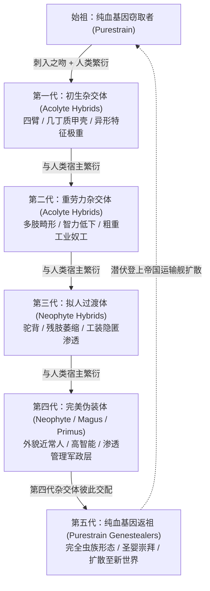

* **第一代：初生杂交体（First Generation Hybrids）**
  * **形态**：人类与纯血结合所生。具三至四臂，覆紫灰几丁质甲壳与金刚石撕裂爪，口鼻萎缩呈肉瘤吻部 [Lexicanum]。
  * **职能**：智力残暴仅能低吼，无法模仿人类语言。潜伏于底巢废墟，充当族长卫队与繁衍工具 [Lexicanum] [官方: Codex: GSC (8th Edition)]。
* **第二代：重劳力杂交体（Second Generation Hybrids）**
  * **形态**：严重驼背，具第三肢萎缩骨刺，面部略显人形但声带与思维逻辑受损 [Lexicanum]。
  * **职能**：能听懂基础机械指令，痛觉迟钝且力大无穷。伪装成工业奴工与矿工，常被帝国官僚误判为“辐射变异劳工”而免遭清剿 [Lexicanum] [Fandom]。
* **第三代：拟人过渡体（Third Generation Hybrids）**
  * **形态**：外表接近人类，大多光头且颅骨微隆。第三臂退化为可被衣服遮蔽的短肢 [Lexicanum]。
  * **职能**：能使用人类语言，熟练操作枪械、工程机械与炸药。渗透至物流中枢、工厂与民兵自卫队充当基层骨干 [Lexicanum] [官方: Codex: GSC (9th Edition)]。
* **第四代：完美伪装体（Fourth Generation Hybrids）**
  * **形态**：解剖学上与人类几无差异，仅带微弱皮疹或骨结，可轻松规避常规肉眼检测 [Lexicanum]。
  * **职能**：具极高智慧与社交魅力。能诞下强灵能大贤者（Magus）与统帅军主（Primus），全面打入行星防卫军（PDF）、商会与总督政界 [Lexicanum] [官方: Codex: GSC (8th Edition)]。
* **第五代：纯血返祖现象（Fifth Generation / Purestrain Genestealers）**
  * **突变机理**：第四代杂交体彼此结合时，泰伦隐性基因发生强烈的**基因返祖暴发（Genetic Reversion）**，母体直接诞下纯净的**纯血基因窃取者** [Lexicanum] [官方: Codex: GSC (8th Edition)]。
  * **职能**：新生纯血体被奉为“神圣天使”，成熟后被秘密送上星际货船货舱，随航运网络扩散至新世界开启新一轮循环 [Lexicanum]。

---

#### 1.3 教派组织架构与层级分工

教派呈现出由灵能共鸣与宗教狂热双重维系的**蜂巢式极权金字塔** [Lexicanum] [官方: Codex: GSC (9th Edition)]：

| 职位 / 单位 | 代际与解剖属性 | 核心战术与社会职能 | 灵能 / 突触属性 | 来源标注文献 |
| :--- | :--- | :--- | :--- | :--- |
| **族长** (*Patriarch*) | 初生纯血特化巨型化 | 潜伏于地底深处王座，教派的心灵源头与绝对神格，发散 Broodmind 控制全族。 | 高阶突触节点 | [Lexicanum] [官方: Codex: GSC (8th)] |
| **大贤者** (*Magus*) | 第四代人类外表灵能突变 | 精神领袖与先知，运用心智惑控术催眠帝国高官、洗脑信徒并操弄政局。 | 凡人灵能突触中继 | [Lexicanum] [官方: Codex: GSC (8th)] |
| **军主** (*Primus*) | 第四代人类外表战术特化 | 最高军事统帅，精通伏击、暗杀与协同作战，战时统率地下杂交武装部队。 | 受族长心智深度链接 | [Lexicanum] [官方: Codex: GSC (9th)] |
| **圣徒 / 圣相旗手** (*Iconward*) | 第一/二代杂交随从骨干 | 高擎神圣符文战旗，激发殉道狂热，散发能让重伤信徒无视剧痛的费洛蒙。 | 信仰/费洛蒙锚点 | [Lexicanum] [官方: Codex: GSC (8th)] |
| **混血信徒** (*Acolytes / Neophytes*) | 第一至四代杂交部队 | 随从（Acolytes）持采矿锯近战破坚；新星（Neophytes）持枪械步兵协同。 | 基层战术单位 | [Lexicanum] [官方: Codex: GSC (8th)] |
| **畸变体** (*Aberrants*) | 杂交繁衍突变怪胎 | 智力退化但肉体怪力惊人，装备动力镐与工业大锤充当活体攻城破门锤。 | 动物性盲从 | [Lexicanum] [官方: Codex: GSC (8th)] |

此外，教派还分化有破坏通讯的**拟音信使（Clamavus）**、调配强化药剂的**生物质炼金士（Biophagus）**与定点狙杀的**暗影刺客（Sanctus）** [Lexicanum] [官方: Codex: GSC (8th/9th Edition)]。

---

#### 1.4 宗教外衣与起义机制：“崛起日”（The Day of Ascension）

##### 1.4.1 宗教包装与阶级矛盾利用
* **“四臂神皇”救赎神话**：教派利用国教在边远世界的包容度，将族长与虫巢意志伪装为**“四臂神皇”**或“星辰救主”[Lexicanum] [官方: Codex: GSC (8th Edition)]。
* **阶级矛盾政治动员**：底层劳工在底巢遭受残酷压榨，教派以互助会为名承诺肉体解放与救赎，将异形寄生伪装为对抗腐败政权的正义起义 [Lexicanum] [官方: Cult of the Warmason (Novel)]。

##### 1.4.2 崛起日的爆发与战术破袭
* **时机**：潜伏期可达数百年。当**虫巢舰队的亚空间阴影笼罩星系**、星语通讯阻断时，族长发出灵能信号，**“崛起日”（The Day of Ascension）**全面爆发 [Lexicanum] [官方: Codex: GSC (8th Edition)]。
* **破袭战术**：
  1. 暗影刺客狙杀总督与军团长；拟音信使瘫痪防空雷达与报警电网 [Lexicanum]。
  2. 混血随从引爆主发电站；生物质炼金士向主供水系统投放神经毒剂 [Lexicanum]。
  3. 潜伏在行星防卫军内的军官倒戈叛乱，调转炮口轰击忠诚派军营，策应空投的泰伦主力，形成内外合流 [Lexicanum] [官方: Codex: GSC (9th Edition)]。

##### 1.4.3 终极破灭与终局悲剧
* **幻梦破灭**：信徒迎接“星辰天使”时，迎来的却是无差别屠杀的先锋虫潮与食腐巨兽 [Lexicanum]。
* **催眠解除**：母舰突触意志接入地表后，诺恩虫后强制剥夺族长对混血后裔的灵能催眠。信徒惊恐发现崇拜的神明只是冰冷的宇宙掠食者 [Lexicanum] [官方: Codex: GSC (8th Edition)]。
* **入池融解**：失去价值的信徒连同族长本人，在吞噬虫群驱赶下被赶入强酸消化池，彻底融解为有机浓汤泵入轨道母舰 [Lexicanum] [官方: Belisarius Cawl: The Great Work]。

---

#### 1.5 著名教派及其与虫巢舰队的关系

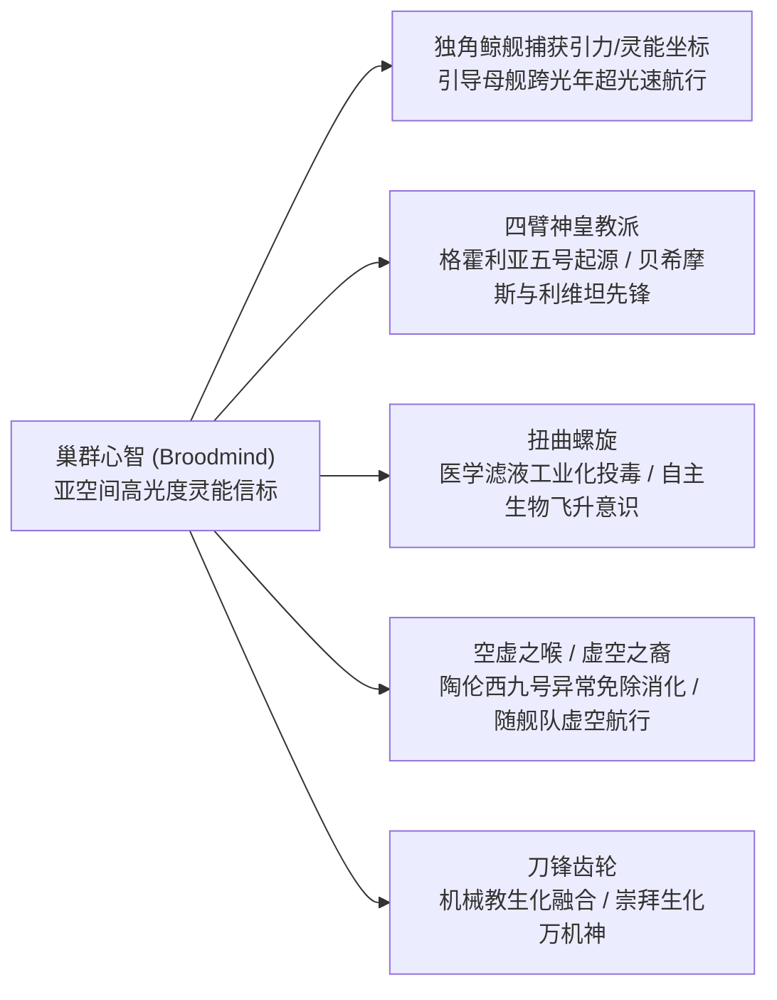

* **四臂神皇教派（The Cult of the Four-Armed Emperor）**：源于格霍利亚五号（Ghosar Quintus），隐匿地底数百年，是银河规模最大教派。审判官查格林失踪后引出死亡守望卡西乌斯小队清剿。该教派是贝希摩斯与利维坦舰队的核心先驱引导者 [Lexicanum] [官方: Deathwatch: Overkill]。
* **扭曲螺旋（The Twisted Helix）**：源于维里迪亚主星（Veridia Prime）。该教派颠覆了舌吻感染，生物炼金学者将异形干细胞伪装成官方抗生素与疫苗工业化散播。信徒自诩“肉体进化的高等人种”，具高度自主改造意识 [Lexicanum] [官方: Codex: GSC (8th Edition)]。
* **空虚之喉 / 虚空之裔（Cult of the Voidbrood）**：源于运输船“佩加辛号”坠毁于霍普菲特斯（Hopefoster）。在陶伦西九号战役后呈现出**罕见的生态特例**——虫巢舰队并未将其投入消化池，而是允许其搭乘运输舰伴随泰伦生物舰航行于深空，成为跨星系协同仆从军 [Lexicanum] [官方: Codex: GSC (8th Edition)]。
* **刀锋齿轮（The Cult of the Bladed Cog）**：源于铸造世界费恩格（Feinng），深度侵蚀护教军与机仆。信徒将机械神教义与几丁质融合，把机械义体与生化利刃拼接，崇拜生化万机神 [Lexicanum] [官方: Codex: GSC (8th Edition)]。
* **心灵信标机理**：信徒与族长构建的**巢群心智（Broodmind）**在亚空间形成强灵能透镜。独角鲸舰借助该信标准确定位星系重力梯度与生物质坐标，实现远距离引力导航 [Lexicanum] [官方: Codex: Tyranids (8th Edition)]。

---

### 第2章 帝国的认知、监控与战略反制

面对大吞噬者，人类帝国确立了融合审判清除、焦土灭绝与战术斩首的综合防线 [Lexicanum]。

#### 2.1 审判庭的监控、侦测与清除

负责泰伦与教派威胁的最高机构为**异形审判庭（Ordo Xenos）** [Lexicanum] [官方: Codex: Inquisition]：
* **异常预警指标**：什一税产出连续下滑暗示底巢叛乱；医疗站畸形婴儿登记异常超标；星语者频繁报告听到高频甲壳摩擦声与窒息感，提示亚空间阴影逼近 [Lexicanum] [官方: Codex: Tyranids (9th Edition)]。
* **生化筛查与瓶颈**：机械教利用血液离心试剂检测泰伦异形蛋白，遇异形基因会产生强酸发热沉淀。但第四代伪装体常能规避粗糙测试，且巢都数百亿人口的普查在后勤上无法实现 [Lexicanum] [Fandom]。
* **终极物理清除**：一旦确认教派掌控政军中枢，审判官动用**灭绝令（Exterminatus）**，发射两极旋风鱼雷焚毁星球大气与地壳，物理截断基因链 [Lexicanum]。

---

#### 2.2 克里普特曼防线与焦土争议

##### 2.2.1 审判官克里普特曼的战略认知
745.M41，审判官克里普特曼（Fodor Kryptman）在泰兰主星抢救出“达克里数据板”，正式将大敌定名为“泰伦”。997.M41利维坦舰队直插帝国腹地，克里普特曼意识到与虫族进行常规阵地战只会不断为其补充生物质养料 [Lexicanum] [官方: Codex: Tyranids (5th Edition)]。

##### 2.2.2 焦土防御圈（Cordon Sanitaire）与绝罚风暴
* **绝罚焦土带**：克里普特曼在利维坦前方划定数十光年的“卫生隔离带”。在虫群抵达前，**他下令对沿途超过30个生机盎然的人类世界提前执行灭绝令**，烧尽植被、水圈与数百亿忠诚子民 [Lexicanum] [官方: Codex: Tyranids (5th Edition)]。
* **战略实效与处分**：焦土剥夺了利维坦急需的能量，迫使其饥饿减速并偏转航道。然而高领主议会震怒，谴责此举为“仅次于荷鲁斯叛乱的灭绝罪行”，剥夺其头衔并宣告其为**“极端绝罚叛徒”（Carta Extremis）** [Lexicanum]。

##### 2.2.3 欧克塔利乌斯赌局（Octarius Gambit）的反噬
* **引狼拒虎**：被放逐的克里普特曼捕获纯血异形投入兽人帝国**欧克塔利乌斯（Octarius）**核心，引诱利维坦主卷须与兽人大军死斗以换取帝国喘息 [Lexicanum]。
* **恶果与争议【重大战术争议】**：战争陷入数十年僵局。最终利维坦吞噬了海量强韧兽人DNA，演化出更致命的近战怪兽并攻陷欧克塔利乌斯核心，反而为帝国孕育了体格更庞大的超级虫潮 [Lexicanum] [官方: War Zone Octarius]。

---

#### 2.3 死亡守望（Deathwatch）的反泰伦战术与基因武器

死亡守望作为异形审判庭的军事铁拳，开发了极具针对性的灭绝战法与生物靶向武器 [Lexicanum] [官方: Codex: Deathwatch (8th/9th Edition)]：

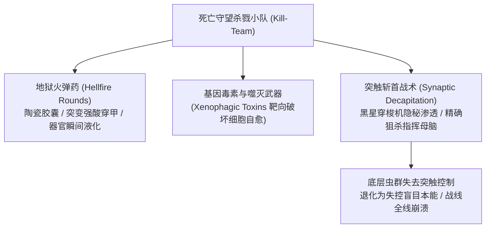

* **地狱火弹药（Hellfire Rounds）**：马库拉格战后研发。常规爆弹无法击穿泰伦重甲几丁质，地狱火弹药将高爆药替换为**陶瓷变异强酸胶囊（Mutagenic Acid）**。击中后强酸腐蚀甲壳，浓缩毒素注入靶向组织，在数秒内瓦解巨兽内部器官与蛋白结构 [Lexicanum] [官方: Codex: Deathwatch (8th Edition)]。
* **基因工程毒素与噬灭武器**：死亡守望在监视要塞中解剖活体样本，逆向破译泰伦基因链，研制出**异形噬灭毒素（Xenophagic Toxins）**与靶向基因毒剂，涂抹于近战武器上精准阻断泰伦细胞的高速自愈与突变机制 [Lexicanum] [官方: Codex: Deathwatch (9th Edition)]。
* **突触斩首战术（Synaptic Decapitation）**：杀戮小队搭乘黑星穿梭机潜入，狙杀突触核心（如虫巢暴君、诺恩使者或族长）。突触灭亡后周围虫群退化为低级“本能行为”（Instinctive Behaviour），陷入抽搐、溃逃或自相残杀，守军趁势反击 [Lexicanum] [官方: Codex: Deathwatch (9th Edition)]。

---

#### 2.4 星界军与阿斯塔特的已知有效战术

##### 2.4.1 星界军（Astra Militarum）的阵地防御铁律
* **饱和火炮洗地**：以连队部署**石化蜥蜴自行火炮（Basilisk）**与**石龙子迫击炮（Wyvern）**实施重叠弹幕，用破片火海在阵地前沿撕碎低阶虫潮 [Lexicanum] [官方: Codex: Astra Militarum (8th Edition)]。
* **焦土壕沟与喷火净化**：工兵利用重油与落叶剂提前清理植被，剥夺李克特潜伏环境；部署**地狱犬装甲车（Hellhound）**喷射超高温化学火胶，持续燃烧烤干几丁质虫壳 [Lexicanum]。
* **政委严酷督战机制**：针对亚空间阴影引起的绝望与士气雪崩，政委通过当场处决逃兵与高唱圣歌，以铁腕纪律维系战壕战线稳定 [Lexicanum]。

##### 2.4.2 阿斯塔特星际战士（Adeptus Astartes）特化突击
* **泰伦战役老兵（Tyrannic War Veterans）**：马库拉格保卫战第一连全体牺牲后，极限战士首席牧师**奥坦·卡西乌斯（Ortan Cassius）**打破圣典教条成立特战连队，全员配备地狱火爆弹枪专司异形猎杀 [Lexicanum] [官方: Codex: Space Marines (5th Edition)]。
* **终结者深空跳帮战（Terminator Boarding Operations）**：终结者小队利用穿甲鱼雷登入敌方生物舰内部，沿着肉质管道突入孕育母腔，使用热熔炸药引爆诺恩虫后或神经主脑，使母舰脑死亡漂流 [Lexicanum] [官方: Space Hulk Rulebook]。

---

#### 2.5 艾达灵族与混沌势力对泰伦的态度

泰伦虫族毫无灵魂波动的纯粹掠食本质，使银河各方文明均面临绝灭危机 [Lexicanum]。

##### 2.5.1 艾达灵族（Aeldari）：终极绝灭大敌
灵族将泰伦称为“大吞噬者”或“无尽贪食者”[Lexicanum]：
* **方舟世界浩劫**：
  * **伊扬登方舟（Iyanden）**：993.M41遭海妖舰队围攻，五分之四人口战死，战后被迫依赖灵骨冥府机体（Wraith constructs）维持防务 [Lexicanum] [官方: Codex: Craftworlds (7th Edition)]。
  * **玛兰泰的悲剧（Fall of Malan'tai）**：突变生物**“玛兰泰之灾”（Doom of Malan'tai）**刺入方舟核心的**无限回路（Infinity Circuit）**，吸干回路内数亿先祖灵魂，证实泰伦具备掠食纯净灵魂的进化能力 [Lexicanum] [官方: Codex: Tyranids (5th Edition)]。
* **瓦勒多战役（Battle of Valedor / Duriel）**：利维坦与海妖分遣队试图在杜列尔汇合交换基因库。方舟灵族（比耶坦、伊扬登）罕见联合黑暗灵族，动用古老神器“火之核心”引爆行星地核，借星体坍缩火海全歼两股主舰队，阻止超级虫潮诞生 [Lexicanum] [官方: Valedor (Novel)]。
* **黑暗灵族（Drukhari）的态度**：泰伦缺乏个体灵魂与恐惧感，无法提供折磨滋养。但科摩罗血伶人（Haemonculi）热衷捕获纯血异形进行解剖，将其几丁质骨板缝合入痛苦引擎与血肉傀儡 [Lexicanum] [官方: Codex: Drukhari (8th Edition)]。

##### 2.5.2 混沌势力（Chaos）：零和死斗与本质相克

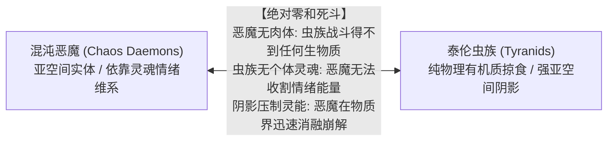

* **“零和死斗”机制**：恶魔由亚空间能量凝结，死后化作虚无，无法提供任何碳基有机物；虫群无独立情绪波动，恶魔得不到任何痛苦恐惧滋养；亚空间阴影甚至能驱散灵能，导致恶魔形体迅速消解崩坏 [Lexicanum] [官方: Codex: Chaos Daemons (8th Edition)]。
* **卡班哈与巴尔之劫（The Devastation of Baal）**：999.M41利维坦围攻巴尔，恐虐大魔**卡班哈（Ka'Bandha）**率恶魔大军降临巴尔卫星。出于“圣血天使的鲜血与颅骨只能由血神收割”的狂怒，卡班哈疯狂屠戮数百万利维坦虫群并堆成颅骨奇观，间接替圣血天使解除了侧翼危机 [Lexicanum] [官方: The Devastation of Baal (Novel)]。
* **克罗诺斯虫巢舰队（Hive Fleet Kronos）**：针对大裂隙孵化的反亚空间特化舰队。克罗诺斯弃用近战，部署重型远程火炮与佐安索普阵列，以超强阴影强行闭合亚空间裂隙驱逐恶魔；利维坦甚至专门为其留下未消化的星球作为补给站 [Lexicanum] [官方: Codex: Tyranids (8th Edition)]。
* **混沌星际战士（CSM）**：视泰伦为破坏掠夺的蝗虫；部分奸奇巫师或阿尔法军团战帮偶有诱导教派暴动以破坏帝国防御的借刀杀人行径 [Lexicanum] [Fandom]。

---

### 第3章 核心术语对照表（Glossary）

| 序号 | 中文术语 | 英文官方术语 | 权威设定释义 |
| :---: | :--- | :--- | :--- |
| 1 | **基因窃取者之吻** | The Genestealer's Kiss | 纯血异形以产卵器将遗传物质刺入宿主肉体并实施神经心智奴役的过程。 |
| 2 | **巢群心智** | Broodmind | 族长与全教派杂交信徒之间构建的区域性灵能共鸣与控制网络。 |
| 3 | **崛起日** | The Day of Ascension | 潜伏教派在虫巢阴影笼罩星系时发动的全面颠覆性武装暴动。 |
| 4 | **族长** | Patriarch | 早期潜入并特化发育的超巨型独立突触源，教派的绝对灵能神格中枢。 |
| 5 | **大贤者** | Magus | 第四代混血信徒中涌现的高阶灵能者，负责心理操弄、宣传与政客洗脑。 |
| 6 | **军主** | Primus | 第四代混血信徒中诞生的军事战略大师，负责教派民兵统帅与战术突袭。 |
| 7 | **四臂神皇** | The Four-Armed Emperor | 教派用于腐蚀国教信仰、诱骗底层劳工的宗教异端伪装神格。 |
| 8 | **克里普特曼防线** | Kryptman's Cordon | 审判官克里普特曼下令提前焚毁数十个世界构筑的绝罚饥饿隔离带。 |
| 9 | **欧克塔利乌斯赌局** | Octarius Gambit | 将纯血异形引入兽人帝国以引诱利维坦主力与之相互残杀的极端战略。 |
| 10 | **地狱火弹药** | Hellfire Rounds | 死亡守望研发的内装变异强酸胶囊、专克几丁质与内脏的特化穿甲弹。 |
| 11 | **突触斩首战术** | Synaptic Decapitation | 优先击杀暴君、族长等节点，迫使低等虫群退化为失控动物本能的战法。 |
| 12 | **泰伦战役老兵** | Tyrannic War Veterans | 马库拉格保卫战后由卡西乌斯牧师建立、专门清剿泰伦的极限战士特战连。 |
| 13 | **玛兰泰之灾** | Doom of Malan'tai | 吸干玛兰泰方舟世界无限回路数亿先祖灵魂的极端突变佐安索普。 |
| 14 | **瓦勒多战役** | Battle of Valedor | 方舟灵族与黑暗灵族罕见联合引爆行星以阻止利维坦与海妖合流的战事。 |
| 15 | **空虚之喉 / 虚空之裔** | Cult of the Voidbrood | 陶伦西九号战役后罕见未被消化、获准伴随活体生物舰航行深空的教派特例。 |

---

---

## 附录：学术辨析与争议考证汇总

### 一、生态与演化篇学术辨析与待考设定

1. **银河系外母体与外域原貌【待考】**：
   * 帝国与灵族目前无法确定泰伦虫族在银河系外是否已经吞噬了成百上千个完整星系，亦无法证实这数支虫巢舰队究竟是全族本体还是仅仅为庞大侦察先锋的触角 [Lexicanum] [官方: Codex: Tyranids (5th/8th Edition)]。
2. **提亚玛特（Tiamet）大陆天线的最终作用【待考】**：
   * 提亚玛特虫巢舰队在齐亚弗里亚星球构筑的巨型大陆级灵能结构，被推测为引导系外大军的主信标，但官方截至战锤40K第十版仍未揭晓其最终共鸣效果 [Lexicanum] [官方: Codex: Tyranids (8th/9th Edition)]。
3. **暴君近卫与星际战士基因同源性【帝国学术争议】**：
   * 机械教《阿斯塔特解剖志异》与审判庭异形审判庭（Ordo Xenos）对暴君近卫黑色甲壳类似物的官方定性为“未证实的异端学说”，但在客观生物解剖事实中具备显著对应结构，本文依 Lexicanum 记载按“机械教假说但具有显著解剖依据”收录 [Lexicanum]。

---

### 二、战役编年史学术争议与考证（Scholarly Appendix & Debates）

针对战锤40K官方文献与帝国记录中存在的战史分歧，进行学术归纳与定性考订：

1. **法洛斯信标是否为唯一诱因【待考/争议】**：
   * 官方正史确证：《荷鲁斯之乱：法洛斯》（Guy Haley 著）明确描述量子脉冲唤醒了河外虚空中的虫巢意志，是官方确立的大吞噬者向银河系变轨的根本原因 [官方]。
   * 设定学术冲突：帝国古生物记录显示M31前银河系内即有芬里斯巨妖、卡塔昌恶魔化石。主流假说倾向于泰伦母体史前曾掠过银河边缘撒下休眠卵，但全族主力确由法洛斯脉冲正式引来 [Lexicanum] [待考/争议]。
2. **克里普特曼焦土政策净收益【争议】**：
   * 官方审判庭定性：克里普特曼被定罪为叛国屠夫，其灭绝令剥夺了人类帝国数十个世界宝贵的数千亿劳动力与工业基础，且未能彻底饿死具备休眠节食能力的泰伦母舰 [Lexicanum] [官方: Codex: Tyranids (5th Edition)]。
   * 激进派战术复盘：激进派学者指出，若无焦土隔离带，利维坦中路将在998.M41直刺空虚的太阳星区，泰拉极可能在大裂隙与不屈远征集结前失陷。该决策冷酷但改变了帝国的灭亡时间线 [Lexicanum] [待考/争议]。
3. **奥克塔利斯战役胜负外溢对第四次泰伦战争的影响【官方考证】**：
   * 针对民间曾误传的“兽人耗死利维坦”说法，官方战役书《War Zone Octarius: Book 2》明确澄清：最终利维坦凭借分子毒素彻底吞噬了奥克塔利斯主星并斩杀大军阀。泰伦在此役吸收的兽人基因，直接促成了第四次泰伦战争中高密度骨甲与近战强化品种的大规模投入 [官方: War Zone Octarius]。
4. **第四次泰伦战争战局走向【设定开放状态 / 待考】**：
   * 截至第十版战役书，第四次泰伦战争仍处于激烈交火的开放状态。索尔之刃战法斩杀了多名虫后，但面对河外未知的庞大母体储备，人类帝国的防御体系依然处于极度紧绷与战术劣势之中 [官方: Warhammer 40,000 (10th Edition)] [Lexicanum]。

---

### 三、虚空舰队与生物舰战术考证与争议说明

1. **独角鲸舰对恒星演化的长期影响【帝国学者假说】**：
   * 部分机械教生物贤者推测，独角鲸舰强行牵引星系重力可能会加速不稳定恒星的核聚变塌缩速度，甚至在某些极端案例中提前诱发恒星耀斑爆发。该理论已获阿斯塔特部分智库馆长证实，但审判庭异形审判庭仍将其列为“伴生引力震荡导致的环境副效应”而非泰伦的主动定向恒星武器 [Lexicanum] [官方: Codex: Tyranids (5th Edition)]。
2. **生物舰几丁质甲壳对宏炮动能的吸收阈值【军备考据】**：
   * 帝国海军兵工署实测数据显示，母舰级生物舰的外生骨骼在经受常规两百米口径宏炮高爆弹轰击时，几丁质断裂处会在数十分钟内由深层分泌的高黏度骨化浆液重新硬化封闭；唯有配备旋风雷弹头（Vortex）与重型激光光矛连续直击，方能在其体表造成不可逆的永久性结构贯通伤 [Lexicanum] [官方: Battlefleet Gothic Armada]。
3. **虚空潜伏者与剃刀魔分类归属【文献辨析】**：
   * 在早期的《Battlefleet Gothic Magazine》与后期《Armada》扩展中，帝国海军对泰伦巡洋舰的命名曾出现过重叠（如将所有装备近战骨突的舰型统称为 Cruiser，而将具体亚型以 Razorfiend、Stalker 等命名）。本文遵循 Lexicanum 最新归纳准则，将“剃刀蜂群舰（Razorfiend）”定性为巡洋舰级的近战破舰专用变体，与常规远程酸液巡洋舰（Devourer 型）并列分类 [Lexicanum] [官方: Battlefleet Gothic Resources]。

---

### 四、基因窃取者教派与反制战略学术辨析与争议设定（Academic Annotations）

1. 虚空之裔（Cult of the Voidbrood）幸存共航之谜【未解特例】
* **官方文献记录**：依据《Codex: Genestealer Cults (8th Edition)》第37页记载，陶伦西九号沦陷后，虫巢舰队罕见赦免了虚空之裔，允许其搭乘运输舰随活体生物舰编队前往深空继续攻伐 [官方: Codex: GSC (8th Edition)]。
* **学术推论**：审判官推论虫巢意志因该教派拥有大量成建制星际货船，保留其作为低能耗肉盾协同作战的效益高于融解入池；亦有假说认为佩加辛号坠毁时的辐射导致族长产生了变异突触共鸣，被误判为高级共生节点 [Lexicanum] [Fandom]。官方未给绝对定论，按战史特例收录。

2. 克里普特曼焦土策略的历史定性争议【帝国法理与战略伦理】
* **法理定性**：高领主议会与审判庭联席裁决将其定性为“未获授权的滔天大罪与叛国行径”，剥夺其头衔并全银河通缉 [Lexicanum]。
* **战略长远得失**：实战表明焦土带确实迟滞了利维坦对太阳星区的推进；但欧克塔利乌斯赌局最终导致利维坦吸收了强韧欧克基因，演化出抗物理重甲怪兽并吞噬该核心区，带来了长远恶果 [Lexicanum] [官方: War Zone Octarius]。

3. 跨物种感染可行性辨析【官方设定沿革】
* **欧克兽人（Orks）**：可被感染产生多臂几丁质杂交绿皮，但无法形成有效教派。因兽人体内存在天生 Waaagh! 灵能共鸣，健康兽人能立刻察觉缺乏“搞毛纯正味”的异类，杂交体在幼年即被群殴击杀 [Lexicanum] [官方: Codex: GSC (8th Edition)]。
* **艾达灵族（Aeldari）**：极度罕见。灵族妊娠周期极长且依赖灵魂交融，先知能迅速察觉亚空间污染并在萌芽期净化，仅在极个别边缘流亡者家族中有零星记录，无法完成五代循环 [Lexicanum] [官方: Ghost Warrior (Novel)]。
* **钛帝国（T'au Empire）**：以太阶级与土道学者严格管理繁衍与体检，受感染的火道战士在第一代即会被隔离无害化清除；然而在钛族边境控制的人类仆从军（Gue'vesa）聚居区中，教派爆发频率极高 [Lexicanum] [官方: Codex: GSC (8th Edition)]。
